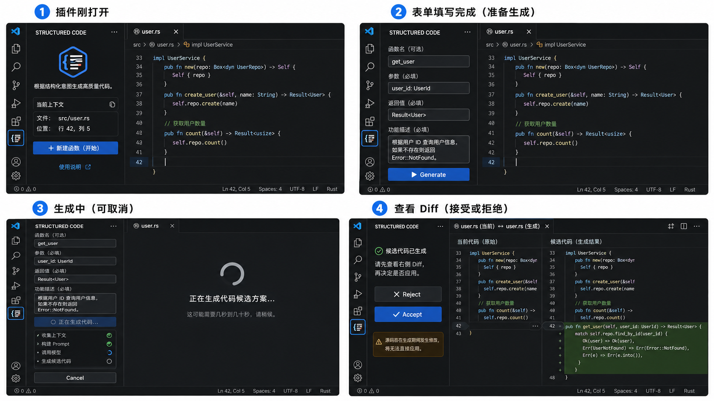

# VS Code 插件 MVP：结构化意图 → 代码

## 1. 核心目标

只验证一个假设：

> **用户通过结构化方式描述函数，是否比普通聊天 Prompt 更高效、更稳定地生成正确代码。**

第一阶段不绑定 Semantic Index、SCIP、Glean、Embedding、Agent 知识库、调用链分析等第二阶段基础设施。

---

## 2. 产品形态

第一阶段产品：

```text
VS Code Extension
+
LLM HTTP API
```

不是：

```text
自研 IDE
Fork VS Code
完整 AI IDE
自主 Agent
```

插件只增强当前 VS Code 编辑流程。

MVP 基于 VS Code Extension 原生承载结构：

```text
VS Code Extension
│
├─ Extension Manifest（package.json Contribution Points）
├─ Sidebar Webview View（表单 UI）
├─ Extension Host（业务逻辑）
├─ VS Code Editor / Language API（上下文采集）
├─ LLM HTTP API（代码生成）
├─ VS Code Diff（候选展示）
└─ WorkspaceEdit（源码写入）
```

大白话：

> VS Code 已经提供编辑器、语言服务入口、Diff 和文件修改能力；插件主要开发的是表单 UI、上下文组织、LLM 调用和业务流程。

---

## 3. 用户流程

用户视角的完整操作流程：

```text
用户正在 VS Code 中编辑源码
↓
将光标放到准备插入新函数的位置
↓
点击 Activity Bar 中的插件图标
↓
Sidebar 打开插件界面
↓
插件立即识别当前文件和光标位置
↓
用户填写结构化函数需求
↓
点击 Generate
↓
插件收集上下文并调用 LLM
↓
Generating 状态，可 Cancel
↓
生成 Candidate Source
↓
VS Code Editor Area 打开原生 Diff
↓
插件 Sidebar 显示 Candidate Ready
↓
用户在 Sidebar 选择 Accept / Reject
↓
Accept：校验 document.version 后 WorkspaceEdit 写入
Reject：丢弃 Candidate，不修改源码
↓
完成
```

大白话：

> 用户一直在 VS Code 中写代码；插件只是打开一个侧边栏控制面板，帮用户描述函数、生成候选代码、查看 Diff，再决定是否写入。

---

## 4. Structured Form

第一版侧边栏只保留 4 项：

```text
函数名：可选
参数：必填
返回值：必填
功能描述：必填
```

例如：

```text
函数名：
get_user

参数：
user_id: UserId

返回值：
Result<User>

功能描述：
根据 user_id 查询用户，
用户不存在时返回 Error::NotFound。
```

不要加入：

```text
上下游函数选择
依赖搜索
调用链
文件选择器
多步骤 Agent 输入
复杂约束配置
```

原因：

> 一旦做上下游选择，就需要 Symbol Index、搜索、跨文件定位、关系查询等基础设施，会把 MVP 拖入第二阶段。

---

## 5. Extension Manifest

插件通过 `package.json` Contribution Points 接入 VS Code：

```text
viewsContainers
→ Activity Bar 插件入口（图标 + 面板 ID）

views
→ Structured Code 侧边栏（WebviewViewProvider 注册）

commands
→ Generate / Accept / Reject 等命令

configuration
→ Model / Base URL 等普通配置（非敏感）
```

不要设计自定义编辑器内核。

---

## 6. VS Code UI

第一版使用 `WebviewViewProvider` 承载侧边栏。

Webview 只负责：

```text
输入框
按钮（Generate / Accept / Reject / Cancel）
Loading 状态
错误提示
```

不要把 LLM、文件读取、API Key、源码修改逻辑放在 Webview 中。

Webview 与 Extension Host 通过消息通信：

```text
Webview → postMessage → Extension Host（表单提交、Accept / Reject / Cancel）
Extension Host → postMessage → Webview（状态 / 错误反馈）
```

生成后进入 Diff，不在侧边栏实现完整代码编辑器。

不要把 UI 做成复杂聊天界面。

具体的 UI 状态和交互行为见 §7 UI / UX 状态与交互。

---

## 7. UI / UX 状态与交互

MVP 有 4 个关键 UI 状态，对应用户操作的完整生命周期。

### UI 原型



原型图用于表达布局和视觉方向，具体行为以本文状态定义为准。其中状态 3 的 Editor Area 应继续显示当前源码，不实现中央 Loading 页面；状态 4 图中的源码变化警告属于独立的 Stale Document 状态，不属于正常 Candidate Ready。

---

### 状态 1：插件刚打开

用户已经打开源码，把光标放到目标位置，点击 Activity Bar 图标。

Sidebar 显示：

```text
STRUCTURED CODE

根据结构化意图生成高质量代码。

当前上下文

文件：
src/user.rs

位置：
行 42，列 5

[ + 新建函数（开始） ]
```

要求：

- 自动读取当前 Active Editor。
- 自动显示当前文件和光标位置。
- 不让用户再手工选择文件。
- 用户点击"新建函数"后进入 Structured Form。
- 如果没有 Active Editor，显示简单空状态并禁用开始操作。

---

### 状态 2：表单填写 / Ready

用户点击"新建函数"后进入表单。

Sidebar：

```text
STRUCTURED CODE

函数名（可选）
[ get_user ]

参数（必填）
[ user_id: UserId ]

返回值（必填）
[ Result<User> ]

功能描述（必填）
[ 根据用户 ID 查询用户信息，      ]
[ 如果不存在则返回 Error::NotFound ]

[ Generate ]
```

要求：

- 四个字段保持现有 MVP 定义。
- Function Name 可选。
- Parameters / Return Type / Description 必填。
- 必填内容未完成时 Generate 禁用。
- 不增加上下游函数选择、文件选择、聊天窗口等功能。
- 表单是用户表达意图的唯一主入口。

---

### 状态 3：Generating

用户点击 Generate 后：

```text
STRUCTURED CODE

<原表单内容保持可见但不可编辑>

正在生成代码...

✓ 收集上下文
✓ 构建 Prompt
◌ 调用模型
○ 生成候选代码

[ Cancel ]
```

Editor Area 继续保持当前源码，不需要自己绘制新的生成页面。

要求：

```text
同一时间只允许一个 generation
Generate → Disabled
Cancel → Enabled
```

Cancel：

```text
中止当前 LLM 请求
↓
不修改源码
↓
保留用户表单
↓
恢复 Ready 状态
```

失败：

```text
不修改源码
保留表单
显示简短错误
允许 Retry / Generate
```

不要为了 MVP 实现复杂任务管理系统。

---

### 状态 4：Candidate Ready + Diff

这是最重要的交互边界。

明确：

```text
插件 Sidebar
=
控制器

VS Code Editor Area
=
代码审查区域
```

生成完成后：

#### Sidebar

```text
STRUCTURED CODE

✓ 候选代码已生成

请先查看右侧 Diff，
再决定是否应用。

[ Reject ]
[ Accept ]
```

#### Editor Area

通过 `TextDocumentContentProvider` + `vscode.diff` 展示：

```text
当前代码（真实文件）
        ↔
Candidate（只读虚拟文档）
```

严禁把 Accept / Reject 做成横跨 VS Code Editor 底部的"全局按钮"。

核心原则：

> Diff 是插件触发的 VS Code 原生编辑器界面；Accept / Reject 属于插件 Sidebar。

---

### Accept 行为

Sidebar 中点击 Accept：

```text
重新获取 TextDocument
↓
检查 URI
↓
检查 document.version
↓
检查目标插入位置仍有效
↓
WorkspaceEdit
↓
workspace.applyEdit()
↓
写入真实源码
↓
关闭 / 清理 Candidate Diff
↓
显示成功状态
```

成功后 Sidebar 显示：

```text
✓ Applied successfully

[ New Function ]
```

`New Function` 清空表单并开始下一次创建。

不要自动继续生成其他代码。

---

### Reject 行为

Sidebar 点击 Reject：

```text
丢弃 Candidate
↓
关闭 Candidate Diff
↓
真实源码不变
↓
返回表单
```

用户填写内容默认保留，方便修改描述后重新 Generate。

---

### Stale Document 状态

保留已有 `document.version` 安全机制，并增加明确 UI 状态。

如果：

```text
生成时 document.version
!=
Accept 时 document.version
```

Sidebar 显示：

```text
Source changed

源文件在生成期间已经发生变化，
候选代码不能安全直接应用。

[ Regenerate ]
```

此时 Accept → Disabled。

不要尝试自动 merge。

---

### 最小异常状态

只覆盖以下高频异常：

```text
No Active Editor
Missing API Key
Untrusted Workspace
Network / LLM Error
Empty / Invalid LLM Result
Stale Document
```

处理原则统一：

```text
永远不修改真实源码
↓
给出简短原因
↓
提供一个明确下一步
```

例如：

```text
No Active Editor
→ Open a source file

Missing API Key
→ Configure

Network Error
→ Retry

Untrusted Workspace
→ 信任 workspace 后重试

Empty / Invalid Result
→ Regenerate

Stale Document
→ Regenerate
```

不要建立复杂错误页面。

---

### 首次配置流程

```text
用户第一次 Generate
↓
检测不到 API Key
↓
Sidebar 提示：
LLM API key is not configured.

[ Configure ]
↓
通过 Extension Host 收集 API Key
↓
保存到 ExtensionContext.secrets
↓
Model / Base URL 使用 VS Code Settings
↓
返回 Structured Form
```

禁止：

```text
在 Webview localStorage 保存 API Key
在普通 settings.json 保存 API Key
在源码中保存 API Key
```

---

### UI 基本要求

```text
遵循 VS Code 原生视觉风格
使用 VS Code Theme Variables
支持 Light / Dark
Sidebar 缩窄时正常 reflow
支持基本键盘 Tab 操作
输入框必须有 label
按钮必须有 disabled / loading 状态
错误信息不能只依赖颜色表达
```

High Contrast 如果现有 VS Code Theme Variable 能自然支持则兼容，不为 MVP 自建主题系统。

不要创建自定义 Design System。

---

## 8. Context Collector

Context Collector 的底层来源对应明确的 VS Code API：

```text
window.activeTextEditor
→ TextEditor
  → TextDocument（源码、languageId、version）
  → Selection / Position（选区、光标）
  → Uri（文件路径）
```

用于获得：

```text
当前文件路径
languageId
document.version
源码全文
当前选区 / 光标位置
附近代码
代码缩进和基础风格
```

信息分两层：

```text
MVP 必需：
当前源码
languageId
Selection / Position
document.version

可选增强（依赖 Language Server）：
Document Symbols → executeDocumentSymbolProvider
Definition → executeDefinitionProvider
Type Definition → executeTypeDefinitionProvider
Hover → executeHoverProvider
```

这些可选能力通过 VS Code Language API / 内置命令请求，但依赖当前语言扩展是否提供对应 Language Server。

Language Provider 不可用时：

> 跳过该信息继续生成，不自行开发 Language Server，不建立 Semantic Index。

关于 import：

> MVP 不必专门解析 import；必要时直接从当前源码上下文提供给模型。

大白话：

> **用户说"我要什么"，插件自动补充"这里有什么东西可以用"。**

---

## 9. Context 边界

第一版默认只允许：

```text
当前文件
+
当前光标 / 选区附近代码
```

不要自动遍历整个 workspace。

如果仅靠当前文件无法生成，可以提示用户缺少上下文，但不要偷偷升级为 Agent 搜索整个项目。

大白话：

> 第一版只看"你现在正在编辑的这个文件附近有什么"，还不试图理解整个代码库。

---

## 10. Prompt Builder

把用户要求和编辑器上下文合并成固定 Prompt：

```text
任务：
在当前代码位置创建一个函数。

用户要求：

函数名：
get_user

参数：
user_id: UserId

返回值：
Result<User>

功能：
根据 user_id 查询用户。
用户不存在时返回 Error::NotFound。

代码上下文：

语言：
Rust

当前文件：
src/user.rs

当前可用 Symbol：
User
UserId
UserRepository
Error

当前代码：
<必要的附近源码>

要求：

1. 遵循现有代码风格。
2. 优先复用已有类型和函数。
3. 只实现用户描述的功能。
4. 不修改其他函数。
5. 不创建其他文件。
6. 只返回候选函数代码，不进行额外解释。
```

完整 Prompt 默认不需要展示给普通用户。

可以保留开发调试模式查看 Prompt，但不作为 MVP 用户主流程。

---

## 11. LLM Provider

第一版不做 Agent。

结构只需要：

```text
Prompt
↓
LLM API
↓
Candidate Code
```

概念上定义一个很薄的 Provider 边界：

```text
generate(prompt)
→
candidateCode
```

第一版只需要支持一种确定的 API 接入方式。

> MVP 使用一个 OpenAI-compatible HTTP API 作为默认 LLM 接口；Provider 多厂商适配不是第一阶段目标。

API Key 安全存储见 §15 安全边界。

不要设计：

```text
多 Agent
Tool Calling
自主搜索
自主修改
任务规划
长期 Memory
```

---

## 12. LLM 输出边界

第一版一次只允许生成：

> 一个函数，或者用户明确要求的一个连续代码块。

禁止：

```text
多个文件
多个无关函数
目录创建
依赖安装
架构重构
自动测试
自动文档
自主扩大需求
```

插件收到结果后还应检查：

```text
结果非空
没有明显多余解释
可以被放入当前文件的目标位置
```

不要为了 MVP 开发复杂代码解析器。

---

## 13. Candidate Code

LLM 返回内容后不能立即修改源文件。

内部流程：

```text
LLM Result
↓
Candidate Code
↓
构造"如果接受后"的候选文件内容
↓
Diff
```

源文件在这个阶段保持不变。

---

## 14. Diff / Accept

不自行开发 Diff 编辑器。使用 VS Code 原生机制：

```text
TextDocumentContentProvider
→ 提供 Candidate Virtual Document（只读）
+
vscode.diff
→ 打开 VS Code 原生 Diff Editor

左侧：当前源码（真实文件）
右侧：Candidate（虚拟文档，只读）
```

Diff 属于 VS Code Editor Area；Accept / Reject 属于插件 Sidebar。

Accept / Reject 的具体行为和 UI 状态见 §7 UI / UX 状态与交互。

不要让 AI 绕过这个流程直接保存文件。

---

## 15. 安全边界

### API Key 与配置

```text
API Key
→ ExtensionContext.secrets / SecretStorage

Model / Base URL 等非敏感配置
→ VS Code Settings（configuration Contribution Point）
```

禁止：

```text
API Key 写入源码
API Key 写入普通配置文件
API Key 存在 Webview localStorage
```

### Workspace Trust

未受信任 workspace 中，不应在用户不知情的情况下读取源码并发送给远程 LLM。

可通过 `workspace.isTrusted` 检查，或在 Extension Manifest 中声明相应能力要求。

原则：

> 未受信任 → 禁止生成，或明确提示用户。

不扩展成完整权限系统。

### 并发修改保护

生成 Candidate 时记录当前：

```text
document URI
document version
目标位置
```

用户点击 Accept 时，如果源码已经被用户或其他插件修改：

```text
当前 document version
!=
生成时 document version
```

则不要直接写入。

应提示：

> 源文件在生成期间已经发生变化，请重新生成或重新确认 Diff。

大白话：

> AI 思考的时候用户可能继续改代码，插件不能拿旧版本结果覆盖新代码。

---

## 16. MVP 架构

第一阶段组件：

```text
VS Code Extension
│
├─ Extension Manifest
│   ├─ viewsContainers（Activity Bar 入口）
│   ├─ views（侧边栏注册）
│   ├─ commands（Generate / Accept / Reject）
│   └─ configuration（Model / Base URL）
│
├─ Webview View
│   └─ Structured Form（表单 + Generate 按钮）
│
├─ Context Collector
│   ├─ Editor Context（TextDocument / Selection / Position）
│   └─ Language Features（可选：Symbols / Definition / Hover）
│
├─ Prompt Builder
│
├─ LLM Provider（OpenAI-compatible HTTP API）
│
├─ Candidate Document（TextDocumentContentProvider，只读虚拟文档）
│
├─ Diff Controller（vscode.diff 打开原生 Diff Editor）
│
└─ Apply Controller（WorkspaceEdit + document.version 校验）
```

主数据流：

```text
Active Editor + Cursor
        ↓
Activity Bar → Sidebar / Structured Form
        ↓
Generate
        ↓
Context Collector（Editor Context + 可选 Language Features）
        ↓
Prompt Builder
        ↓
LLM Provider（HTTP API）
        ↓
Candidate Source → TextDocumentContentProvider
        ↓
VS Code Native Diff（Editor Area）

┌───────────────────────────┐
│ Sidebar                   │
│ Candidate Ready           │
│ [ Reject ] [ Accept ]     │
└───────────────────────────┘
              ↓ Accept
document.version 校验
              ↓
WorkspaceEdit + workspace.applyEdit()
              ↓
Source Code
```

---

## 17. 暂不实现

```text
聊天系统
Agent 自主规划
Agent Tool Calling
多文件修改
自动测试
自动文档
自动依赖安装
调用链自动分析
Semantic Index
SCIP
Glean
Embedding
Vector Database
CFG / Data Flow
项目级代码知识库
自动影响范围分析
Git 自动提交
Fork VS Code
自定义编辑器内核
自建 Language Server
自定义 Diff Editor
自动 merge Stale Candidate
```

这些都不是验证 MVP 所必需的。

---

## 18. 验证指标

### 表达效率

记录：

```text
填写结构化表单所需时间
是否需要额外补充 Prompt
生成次数
```

目标：

> 用户是否能用比聊天 Prompt 更少的信息完成需求表达。

### 代码正确率

检查：

```text
函数签名
参数类型
返回类型
已有 Symbol 使用
功能符合描述
代码风格
语法 / 编译结果
```

第一阶段可以人工或通过已有语言工具验证，不需要开发自动测试 Agent。

### 用户接受率

记录：

```text
直接 Accept
修改后使用
Reject
重新 Generate
```

如果需要持久化指标，只保存必要统计数据，不保存用户完整源码和 Prompt。

---

## 19. 完成标准

一个完整例子：

```text
用户打开：
src/user.rs

↓

光标放到目标位置

↓

打开插件侧边栏：

函数名：
get_user

参数：
user_id: UserId

返回：
Result<User>

功能：
根据 UserId 查询用户，不存在返回 NotFound

↓

插件从当前文件获得：

Rust
User
UserId
UserRepository
Error
附近源码
已有 imports

↓

构建固定 Prompt

↓

LLM 返回：

fn get_user(user_id: UserId) -> Result<User> {
    UserRepository::find(user_id)?
        .ok_or(Error::NotFound)
}

↓

生成 Candidate Source

↓

VS Code Diff

↓

用户 Accept

↓

WorkspaceEdit 写入 src/user.rs
```

到这里，MVP 1 完成。

---

# 第二阶段：代码 → 结构化函数上下文

第二阶段是独立问题：

> **根据真实代码，反向生成一份高密度的"结构化函数提示词"，让 Agent 不必重新通读大量源码。**

MVP 1 和 MVP 2 的关系：

```text
MVP 1
VS Code 插件负责：
结构化意图 → 代码

MVP 2
插件后续增加：
代码 → 结构化知识
```

整体流程：

```text
Source Code
↓
程序提取 Code Facts
↓
AI 理解当前实现
↓
Structured Function Context
↓
Agent Context
```

---

## Function Context 组成

### 1. Code Facts

程序可以确定的事实：

```text
参数
返回值
类型
caller
callee
references
location
```

大白话：

> **这些都能直接从代码里查，不需要 AI 猜。**

### 2. Current Implementation Semantics

AI 根据代码和 Facts 反推：

```text
职责
实现逻辑
输入输出含义
错误行为
关键约束
在调用链中的作用
```

大白话：

> **这是"这段代码现在到底在干什么"。**

### 3. Original Intent

用户最初提供的设计要求。

### 4. Intent ↔ Implementation Diff

比较：

```text
最初想怎么做
vs
现在实际上怎么做
```

用于判断实现是否已经偏离原始设计。

---

# 必须区分：实现 ≠ 意图

代码只能证明：

```text
Current Implementation
```

不能证明：

```text
Original Intent
```

例如代码现在是：

```text
用户不存在 → DefaultUser
```

只能得出：

```text
当前实现会返回 DefaultUser
```

不能得出：

```text
最初设计就要求返回 DefaultUser
```

因此长期最好同时保存：

```text
Original Intent
+
Current Implementation
```

这样才能发现设计漂移。

---

# 第二阶段最终产物

一个函数最终可以得到：

```text
函数：get_user

职责：
根据 UserId 查询用户。

输入：
user_id: UserId

输出：
Result<User>

实现：
Repository 查询
→ 错误直接返回
→ 不存在转为 NotFound
→ 存在返回 User

上游：
handle_request

下游：
UserRepository::find

相关类型：
UserId / User / Error

源码：
src/user.rs:120-126
```

Agent 拿到后，只需针对性查看相关源码，而不用重新搜索函数、调用关系、类型并猜测功能。

---

# 两阶段边界

```text
MVP 1
结构化意图
↓
AI
↓
代码

────────────

MVP 2
代码
↓
Code Facts + AI 理解
↓
Structured Function Context
↓
Agent Context
```

核心可以压缩成两句话：

> **MVP 1：验证"结构化意图 → 代码"是否成立。**

> **MVP 2：验证"代码 → 结构化知识 → Agent Context"是否成立。**

其中第二阶段最核心的产物是：

> **Code Facts + Current Implementation Semantics。**

加入 `Original Intent` 后，进一步可以判断：

> **代码现在怎么工作，以及它是否已经偏离最初设计。**

第二阶段才考虑：

```text
跨文件 Symbol
references
caller / callee
Semantic Index
SCIP
项目级关系查询
结构化函数知识
Agent Context
```

禁止为了让第二阶段描述更完整，而提前修改 MVP 的技术范围。