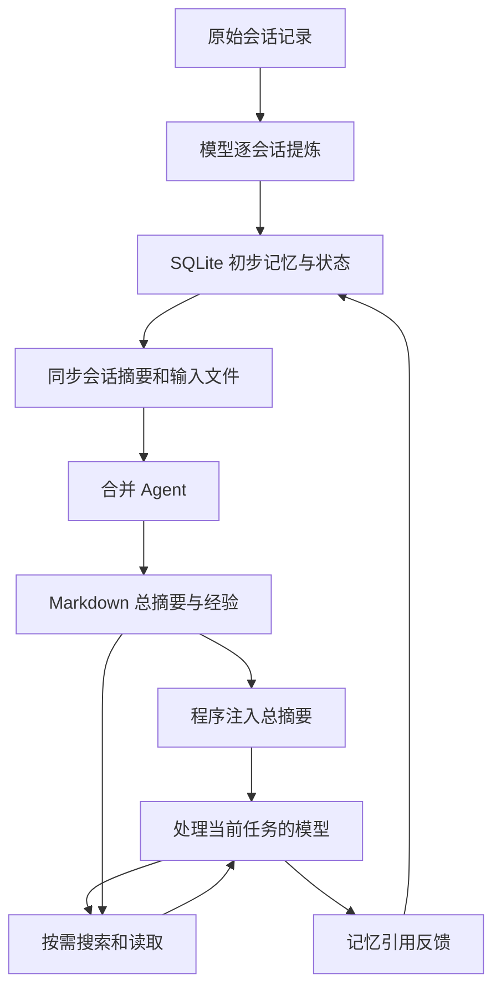

# Codex 记忆系统：框架、源码实现与 Agent 执行手册

**Codex 把旧会话中的经验提炼出来，存进 SQLite，再整理成 Markdown。新会话先读取记忆摘要，相关时再搜索经验正文和来源。**

这份文档把此前讨论中的框架、实现、判断条件和边界合在一起。它既供人阅读，也给 Agent 提供可执行的查找、核对和实施步骤。

Markdown 是带标题和列表标记的文本格式。SQLite 是保存在本地文件中的数据库。本文用“原始会话记录”解释源码里的 rollout。

## 0. 阅读约定与证据范围

### 0.1 固定版本

本文依据 `openai/codex` 的提交：

```text
ce0323f2f2d3b25e82806cd555237da3db4e1897
```

该提交时间为 2026-10-17。本文整理日期为 2026-10-18。**它是一个固定源码快照，不代表此后所有版本的行为。**

默认配置使用 V1。涉及 V2 时，本文单独标出。记忆总开关默认关闭；下文描述正常工作流程时，假设该功能已开启。[S03][S04][S05]

### 0.2 三种表述

| 标记 | 含义 |
|---|---|
| 源码事实 | 可以从固定提交中的执行代码、数据结构或提示词确认 |
| 实现推断 | 根据实现分工得出的解释；不代表作者公开说明过设计动机 |
| 实施建议 | 给自建 Agent 的做法；不是声称 Codex 已这样实现 |

源码中的**程序校验**与**提示词要求**也要分开：

- 程序校验：代码实际检查。检查失败会改变执行结果。
- 提示词要求：写给模型的规则。不能把它当成代码已经逐项强制检查。

例如，V1 提示词要求经验手册具有固定标题结构，但写后校验没有逐项解析全部标题。[S12][S50]

### 0.3 本文不声称什么

- 不把本地 Codex 的时间参数套到 ChatGPT 网页版。
- 不把文档式结构的相似性说成作者之间的借鉴关系。
- 不把静态阅读测试代码说成测试已经运行通过。
- 不把示例路径、示例任务或示例命令说成真实用户事实。
- 不把模型生成的记忆直接当成当前项目事实。需要时仍检查当前源码。

### 0.4 阅读路线

| 目的 | 阅读范围 |
|---|---|
| 先懂整体框架 | 第 1—6 节 |
| 懂何时生成、怎样生成 | 第 7—9 节 |
| 懂如何注入、搜索和使用 | 第 10—11 节 |
| 懂修改、遗忘、配置和 V2 | 第 12—14 节 |
| 给 Agent 执行或移植 | 第 15—20 节 |
| 核对结论和来源 | 第 21—22 节 |

文中 `[Sxx]` 指向固定提交中的源码。`[Oxx]` 指向公开资料。完整索引在第 22 节。

## 1. 先把整体框架说清楚

### 1.1 从结果出发

模型能够使用过去的经验，直接原因是：

1. 程序把保存过的文字放进本次模型输入。
2. 模型读到这些文字。
3. 模型据此回答问题或选择行动。

存到磁盘或数据库，只解决“以后还能取到”。**真正让记忆参与当前任务的动作，是把文字送进模型输入。**[S17][S18]

### 1.2 从三个角度看同一套系统

| 角度 | 应该怎样划分 |
|---|---|
| 人类理解的阅读结构 | 记忆摘要 → 整理后的记忆文档 → 原始会话 |
| 程序的存储分工 | SQLite 保存初步记忆和状态；Markdown 提供整理后的阅读入口 |
| 程序的工作流程 | 第一阶段逐会话提炼；第二阶段合并；使用阶段注入和按需检索 |

不要把这三种划分混成一张“固定层级表”。

“三层”是便于理解的归纳。源码没有声明一个名为“三层架构”的固定类型。进一步拆开阅读深度，也可以得到“概况、经验手册、会话细节或操作流程、原始会话”四级。两种数法描述的是同一条读取路径。[S19]

### 1.3 谁负责什么

| 主体 | 直接负责的动作 |
|---|---|
| Rust 程序 | 检查开关、筛选会话、申请任务锁、调用模型、存取数据、注入摘要 |
| 提炼模型 | 判断一次会话中哪些内容值得留给以后使用 |
| 合并 Agent | 阅读新增、修改和删除的输入，维护长期记忆文件 |
| 当前任务模型 | 根据当前问题选关键词、请求搜索、读取相关经验、决定怎样使用 |
| 文件或命令工具 | 实际读取文件、比较文字、返回命中片段 |
| SQLite | 持久保存行记录，并支持筛选、计数、事务和任务协调 |

“模型搜索文件”的实际意思是：**模型输出工具名和参数；程序执行工具；工具把文字结果交回模型。**[S02][S06][S10][S20][S22]

### 1.4 总体数据关系



图中最后一条反馈线是使用次数和最近使用时间的更新。它不会自动证明该条记忆正确。[S13][S29]

### 1.5 自动记忆、会话历史和 AGENTS.md 分别解决什么

| 对象 | 主要内容 | 目的 |
|---|---|---|
| 原始会话历史 | 当时保存的消息、调用和结果 | 恢复会话，或追查当时发生过什么 |
| 自动记忆 | 从过去会话中提炼、合并的经验 | 帮助后续任务减少重复探索 |
| `AGENTS.md` 等规则文件 | 人工或项目维护的工作要求 | 声明当前项目应该怎样工作 |

自动记忆会筛选、合并和过期。需要持续适用的团队规则，应当保存在规则文件或版本管理中的项目文档。原始历史、规则读取和自动记忆是不同入口。[S59][S60][S61][O02]

## 2. 阅读结构：三层概括，四级深度

### 2.1 三层概括

| 层 | 内容 | 读取方式 |
|---|---|---|
| 记忆摘要 | 用户概况、偏好、通用提示、主题导航 | 程序自动加入模型上下文 |
| 整理后的记忆文档 | 经验手册、会话摘要、可复用操作流程 | 模型按任务需要搜索和读取 |
| 原始会话记录 | 当时保存的消息、工具调用和工具输出等 | 需要原始证据时再追查 |

这里的“Wiki 层”只是对第二层的类比。源码没有要求建立一个名为 `wiki/` 的总目录。[S19][S50]

### 2.2 进一步拆成四级

| 阅读深度 | 对象 | 作用 |
|---|---|---|
| 1 | `memory_summary.md` 加读取说明 | 先知道用户偏好、过去做过什么、去哪里找 |
| 2 | `MEMORY.md` | 找到适用范围明确、可以直接复用的经验 |
| 3 | `rollout_summaries/*.md` 或 `skills/*/SKILL.md` | 补充会话细节、证据或完整操作流程 |
| 4 | `rollout_path` 指向的原始会话 | 核对精确命令、错误、顺序和原始证据 |

`rollout_summaries/` 与 `skills/` 是并列来源。模型不需要先读完一种，才能读另一种。

这些是阅读深度。它们不是四级嵌套文件夹，也不是每次都必须从头走到尾。内容已经够用时，可以停止读取。[S19]

### 2.3 MEMORY.md 不能只当作 index.md

**`MEMORY.md` 同时有来源索引和经验正文。**

源码要求它按项目、工作目录、任务或工作流程分组，并保存：

- 适用范围。
- 相关会话摘要路径。
- 检索关键词。
- 用户偏好正文。
- 可复用知识正文。
- 失败原因、修复方法和防止重犯的做法。

它没有被规定为“把全部文档按名称、路径、摘要逐个列出”的完整目录。[S50]

若只对应“简短导航”，更接近 `memory_summary.md` 中的 `What's in Memory` 部分。这个部分用于提示模型该搜索哪些主题。[S50]

### 2.4 一个小例子

以下是虚构示例：

| 位置 | 内容 |
|---|---|
| 记忆摘要 | 示例项目有特定的测试顺序，可搜索“代码生成、构建” |
| 经验手册 | 修改接口后，先生成代码，再运行测试 |
| 会话摘要 | 当时用过哪些命令、哪里失败、怎样验证通过 |
| 原始会话 | 当时保存的消息和工具输出 |

经验手册中的做法已经足够明确时，模型可以直接使用。需要确认细节时，再往后读。

## 3. 它和 RAPTOR、GraphRAG、LLM Wiki 有什么关系

### 3.1 按实际组织方式比较

| 方案 | 关键组织动作 |
|---|---|
| RAPTOR | 把相近文本分组并生成摘要，再对摘要重复这个过程，形成多层摘要树 |
| GraphRAG | 提取实体和关系，建立图，再对图中的群组生成摘要 |
| Karpathy 的 LLM Wiki | 让模型持续维护 Markdown 主题页、目录和交叉链接 |
| Codex V1 | 让模型维护总摘要、任务经验手册、会话摘要和可选技能文件 |

RAPTOR 与 GraphRAG 都可以预先整理知识，但它们有具体的建树或建图步骤。[O03][O04]

在本文核对的 Codex 记忆读写路径中，组织和查找的核心是 Markdown 文件、标题、关键词和来源路径。专用搜索工具的本地实现逐行比较文字。[S20][S49][S50]

因此，**从结构上看，Codex 更接近文档式 Wiki。**这只是结构比较，不是作者之间借鉴关系的证据。[O05]

### 3.2 渐进式披露说的是“给模型读多少”

渐进式披露的直接动作是：

1. 先把较短的记忆摘要送给模型。
2. 模型发现相关主题。
3. 模型请求读取更具体的文件或段落。
4. 程序把这些文字加入后续模型输入。

这样，大量历史留在存储中，本次只读取相关部分。[S17][S18][S19]

它可以和不同的存储或索引方式组合。不能只因为有“摘要和细节”，就认定实现了 RAPTOR；也不能只因为文档之间有链接，就认定实现了 GraphRAG。

## 4. 默认目录、版本目录和源码模块

### 4.1 运行时数据目录

以下是核心位置。它们是运行后保存的数据，不是 GitHub 仓库的源码目录。

默认 `CODEX_HOME` 为 `~/.codex`。环境变量可以改变这个根目录。SQLite 根目录还可以单独配置；因此数据库未必总在同一个物理位置。具体路径应由当前配置解析，不要在 Agent 中硬编码。[S03][S15]

| 相对位置 | 保存内容 | 读写主体 |
|---|---|---|
| `sessions/` | 未归档的原始会话记录 | 会话记录程序；记忆提炼程序读取 |
| `archived_sessions/` | 归档会话记录 | 会话归档程序 |
| `memories/memory_summary.md` | V1 总摘要和主题导航 | 合并 Agent 写；程序注入 |
| `memories/MEMORY.md` | V1 长期经验手册 | 合并 Agent 写；当前任务模型按需读取 |
| `memories/rollout_summaries/*.md` | 被选入合并输入的会话摘要 | 程序从 SQLite 同步 |
| `memories/raw_memories.md` | 初步经验的合并输入文件 | 程序从 SQLite 重建 |
| `memories/skills/<名称>/SKILL.md` | 可复用流程，可选 | 合并 Agent 维护；当前任务模型读取 |
| `memories/extensions/<扩展>/instructions.md` | 如何解释该类附加记忆输入 | 程序提供或扩展提供 |
| `memories/extensions/ad_hoc/notes/*.md` | 用户明确要求的记忆修改便条 | 当前任务 Agent 写；合并 Agent 应用 |
| `memories/extensions/<扩展>/resources/*.md` | 扩展提供的其他输入 | 对应扩展写；合并程序清理和读取 |
| `memories/phase2_workspace_diff.md` | 本轮相对上次成功基线的文件差异 | 程序生成；合并 Agent 读取 |
| `memories/.git/` | 合并差异使用的本地基线 | 程序维护 |
| `memories_1.sqlite` | V1 初步记忆、任务和合并进度 | 程序 |
| `state_5.sqlite` | 会话目录、路径、时间、来源及记忆模式等 | 程序 |

原始会话可能被压缩。记忆读取代码通过已有的会话读取器访问记录，不能只假定所有输入都是未压缩的纯文本文件。[S08][S60][S61]

这里的 Git“基线”指上次成功处理后保存的一份文件状态。程序把当前文件与它比较，找出本轮变化。

### 4.2 V2 的独立位置

| 内容 | V1 | V2 |
|---|---|---|
| 文档根目录 | `memories/` | `memories_v2/` |
| 记忆数据库 | `memories_1.sqlite` | `memories_v2_1.sqlite` |
| 总摘要 | 有 | 有 |
| 会话摘要目录 | 有 | 有 |
| `raw_memories.md` | 生成 | 这条 V2 管线不生成 |
| `MEMORY.md` | 要求存在 | 不要求生成 |
| 记忆技能层 | 可选生成 | 这条 V2 管线不生成 |

两个版本共用源会话目录信息，分别保存记忆输出和任务状态。V2 的数据库按需建立。详细区别见第 14 节。[S05][S15][S16]

### 4.3 同一个根目录内，项目怎样区分

默认 V1 的记忆目录不是“每个项目各建一套独立数据库”。

提炼候选查询没有按当前工作目录或项目 ID 限定来源。模型通过 `MEMORY.md` 的任务组、`scope`、`applies_to` 和来源路径区分使用范围。[S13][S50]

这意味着：

- 同一 `CODEX_HOME` 可以积累不同项目的经验。
- 经验必须注明适用的目录、分支或工作流程。
- 模型不能把一个项目的规则直接推广到所有项目。

### 4.4 源码按职责拆在哪里

| 源码位置 | 职责 |
|---|---|
| `app-server/.../turn_processor.rs` | 在符合条件的新一轮输入后触发后台任务 |
| `memories/write/src/start.rs` | 检查总开关，启动两阶段后台任务 |
| `memories/write/src/phase1.rs` | 逐会话提炼 |
| `memories/write/src/phase2.rs` | 全局合并、跟踪 Agent 和处理结束状态 |
| `memories/write/src/storage.rs` | 从数据库结果生成输入 Markdown |
| `memories/write/src/workspace.rs` | Git 基线、差异和合并后校验 |
| `ext/memories/src/extension.rs` | 加入读取上下文，并按配置注册专用工具 |
| `ext/memories/src/prompts.rs` | 读取总摘要，组合读取说明 |
| `ext/memories/src/local/` | 本地文件搜索、读取、列目录和添加便条 |
| `state/src/runtime/memories.rs` | 数据库筛选、任务协调、计数、保留与清理 |
| `memories/read/src/` | 记忆引用解析和读取使用分类 |

仓库 README 中部分旧路径还指向 `core/src/memories/`。本文按固定提交中的真实文件位置说明。[S01][S02][S06][S10][S17]

## 5. 各类 Markdown 的内容和关系

### 5.1 memory_summary.md：直接进入模型输入的摘要

主要内容是：

- 用户概况。
- 用户明确表达、可以复用的偏好。
- 通用操作提示。
- 过去工作主题的简短导航。

V1 合并提示词要求第一行是 `v1`。它还要求摘要保持紧凑，把任务细节和证据放到更深的文件中。[S50]

V2 同样要求首行为 `v1`。这里的文本标记不能用来判断当前选择的是 `memories.version = "v1"` 还是 `"v2"`。[S12][S38]

读取程序最多向读取提示中加入约 2,500 tokens 的摘要文字。token 是模型处理文字的计量单位，不等于汉字数。本文不把该值换算成固定中文字数。[S18][S23]

### 5.2 MEMORY.md：经验正文加来源索引

源码要求按任务组组织。任务组可以对应项目、工作目录、工作流程或某类具体任务。[S50]

| 部分 | 作用 |
|---|---|
| `Task Group` | 标出任务组 |
| `scope` | 说明覆盖范围、适用时机和边界 |
| `applies_to` | 说明目录、检出副本或时间范围等适用条件 |
| `Task <n>` | 区分组内不同任务和结果 |
| `rollout_summary_files` | 指向相关会话摘要，保留原始会话路径和来源信息 |
| `keywords` | 给文件搜索使用的具体词语 |
| `User preferences` | 可以在类似任务中复用的用户偏好 |
| `Reusable knowledge` | 可以直接使用的知识和步骤 |
| `Failures and how to do differently` | 现象、原因、修复和防止重犯的经验 |

以下是虚构的格式示例。可选部分按实际证据填写：

```markdown
# Task Group: 示例项目的构建与测试

scope: 修改接口后生成代码并运行测试
applies_to: cwd=/example/repo; reuse_rule=仅用于该仓库当前构建流程

## Task 1: 修复生成代码缺失导致的构建失败，已验证

### rollout_summary_files

- rollout_summaries/example.md (cwd=/example/repo, rollout_path=/example/session.jsonl, updated_at=2026-10-18T00:00:00Z, thread_id=00000000-0000-0000-0000-000000000001)

### keywords

- generate-code, build, generated-api

## Reusable knowledge

- 修改接口定义后，先生成代码，再运行测试。[Task 1]

## Failures and how to do differently

- 直接构建会缺少生成文件。先检查生成步骤是否完成。[Task 1]
```

关键词用于定位文字。它们不是 SQLite 文档元数据索引，也不是向量。

### 5.3 rollout_summaries/*.md：一次会话的整理结果

程序为每条选中的记录生成会话摘要文件。文件前部写入：

- `thread_id`。
- `updated_at`。
- `rollout_path`。
- `cwd`。
- 可选的 Git 分支信息。

后面追加模型生成的 `rollout_summary`。[S11]

这些文件是 Markdown。原始会话另由 `rollout_path` 指向。不要把会话摘要当成原始 JSONL 会话日志。

### 5.4 skills/：可复用做法

`skills/<名称>/SKILL.md` 可以保存跨类似任务复用的操作流程。可选子目录包括脚本、模板和例子。

这不是 V1 每次都必须生成的输出。它也不等同于 Codex 所有其他位置的技能库。这里说的是记忆合并任务维护的可选技能。[S19][S50]

### 5.5 raw_memories.md：初步经验合集

名字里的 `raw` 指“尚未全局合并的初步记忆”。

它已经是模型提炼后的文字，不是原始聊天记录。程序按稳定的会话 ID 升序重建该文件，减少输入排序改变造成的无意义差异。[S11]

## 6. SQLite 与 Markdown 怎样配合

### 6.1 两者都保存内容

第一阶段先把提炼结果写入 SQLite。第二阶段再选择记录并同步成 Markdown。因此，一份会话摘要可以同时存在于数据库和文件中。[S06][S11][S13]

| SQLite 中的内容 | 对应文档或用途 |
|---|---|
| 单会话 `raw_memory` | V1 中写入 `raw_memories.md` |
| 单会话 `rollout_summary` | 写入 `rollout_summaries/*.md` |
| 使用次数和时间 | 决定合并时优先选哪些记录 |
| 任务状态和锁 | 决定谁可以处理、是否需要重试 |
| 合并进度 | 记录版本预热情况 |

`MEMORY.md` 和 `memory_summary.md` 是合并 Agent 维护的高层输出。它们不是 `stage1_outputs` 中一行记录的直接逐字副本。

### 6.2 stage1_outputs：单会话结果

下表覆盖记忆迁移中定义的字段。[S14]

| 字段 | 含义 |
|---|---|
| `thread_id` | 会话 ID，主键 |
| `source_updated_at` | 该提炼结果对应的源会话更新时间 |
| `raw_memory` | V1 初步经验；V2 适配写入时可以为空字符串 |
| `rollout_summary` | 会话摘要 |
| `rollout_slug` | 可选短名称，用于摘要文件命名 |
| `generated_at` | 本次结果生成时间 |
| `usage_count` | 被记忆引用反馈计入的使用次数，可为空 |
| `last_usage` | 最近一次被计入使用的时间，可为空 |
| `selected_for_phase2` | 上次成功合并是否选择了这条来源 |
| `selected_for_phase2_source_updated_at` | 上次成功合并实际使用的来源版本时间 |

`generated_at` 和 `source_updated_at` 不是同一概念。前者是生成时刻，后者是输入会话的版本时间。

### 6.3 jobs：任务状态

| 字段 | 含义 |
|---|---|
| `kind` | 第一阶段任务或全局合并任务 |
| `job_key` | 第一阶段用会话 ID；第二阶段用全局键 |
| `status` | 等待、运行、完成或错误等状态 |
| `worker_id` | 当前处理者 |
| `ownership_token` | 这一次领取任务的所有权令牌 |
| `started_at`、`finished_at` | 本次任务开始和结束时间 |
| `lease_until` | 所有权有效期 |
| `retry_at` | 失败后最早可以重试的时间 |
| `retry_remaining` | 重试计数 |
| `last_error` | 最近错误 |
| `input_watermark` | 任务已知的输入版本标记 |
| `last_success_watermark` | 上次成功处理的输入版本标记 |

`watermark` 可以理解为“处理到哪个输入版本”。这里不是向量检索中的分数。[S13][S14]

这里的“事务”指一组数据库修改一起提交。它帮助程序同时更新任务状态和结果；它不把普通文件写入也自动纳入同一次提交。

### 6.4 consolidation_progress：预热进度

另一个表记录 `max_thread_count`：历史上成功合并过的不同源会话数的最大值。

普通清理不会把这个历史最大值降回当前输入数量。显式重置会清除它。它用于 V2 的就绪判断，详见第 14 节。[S42][S51]

### 6.5 为什么这样分工

以下是**实现推断**：

- SQLite 方便程序按时间、状态、使用次数筛选，并通过事务协调并发。
- Markdown 方便模型调用现成的文件工具搜索、读取和修改。
- 文件差异可以直接交给合并 Agent，帮助它识别新增、修改和删除。

源码实际使用了这几种能力。[S10][S12][S13][S20]

SQLite 同样能存储和搜索正文。本文不把选用 Markdown 解释为“数据库不能存记忆”。


## 7. 何时触发，哪些会话可以提炼

### 7.1 触发点是一次符合条件的新一轮输入

在 app-server 的 `turn_processor.rs` 中，代码要求：

- 本轮有输入。
- 这次提交实际启动了一轮，而不是向已经运行的轮次追加输入。
- 主执行环境已经配置好。

然后调用 `start_memories_startup_task`。[S01]

后台入口继续检查：

- 当前会话不是临时会话。
- `features.memories` 已开启。
- 当前来源不是非根 Agent 会话。
- 记忆数据库可用。
- 记忆目录可以准备完成。
- 配额检查允许本轮生成。

通过后，程序在当前进程中启动异步任务，先运行第一阶段，再尝试第二阶段。[S02]

**它不是等待“用户宣布会话结束”的事件。**在这条调用路径中，也没有为每条会话设立“闲置满 6 小时便自动唤醒”的独立闹钟。

程序退出后，不能假定这个进程内任务还会继续运行。

### 7.2 第一次使用时会发生什么

从零开始、没有其他旧会话时：

1. 当前会话被排除在本次提炼候选之外。
2. 第一阶段没有旧会话可以提炼。
3. 第二阶段仍可能为初始化或补齐缺失输出调用合并模型。
4. 初始化文件不代表已经积累了用户经验。

“没有旧会话可提炼”和“这一轮绝不会调用任何记忆模型”是不同判断。[S06][S10][S12]

### 7.3 候选筛选规则

默认 V1 的候选必须符合以下规则。[S03][S13][S60]

| 条件 | 源码行为 |
|---|---|
| 会话来源 | 来源在允许的交互来源列表中 |
| 允许来源 | CLI、VS Code，以及字面值为 `atlas`、`chatgpt` 的自定义来源 |
| 归档状态 | 候选查询不选归档会话 |
| 记忆模式 | `threads.memory_mode = 'enabled'` |
| 当前会话 | 排除触发这次扫描的会话 ID |
| 最近更新时间 | 距现在不超过配置的年龄窗口，默认 10 天 |
| 闲置时间 | 距最近更新时间至少 6 小时 |
| 是否已处理 | 已成功处理过当前版本则跳过 |
| 任务所有权 | 未被其他有效任务占用 |
| 失败状态 | 重试等待和重试计数允许继续 |
| 扫描上限 | 数据库候选扫描上限为 5,000 |
| 本次领取上限 | 默认最多领取 2 个 |

来源字符串 `chatgpt` 不能作为“ChatGPT 网页记忆使用同一套实现”的证据。

### 7.4 时间到底取哪个值

判断依据是数据库记录的**会话更新时间**，不是浏览器关闭时间、聊天标题时间或第一条消息时间。

候选筛选使用 `threads.updated_at_ms`，单位为毫秒。提交给记忆版本判断的 `source_updated_at` 转为秒级时间戳。移植时必须区分单位。[S13]

年龄窗口也按“最后更新时间”计算。一条很早创建、最近又继续使用的会话，仍可能进入候选。

### 7.5 怎样避免反复总结同一份内容

程序检查两种记录：

- `stage1_outputs.source_updated_at`。
- 该会话任务的 `last_success_watermark`。

只要已有成功记录覆盖当前源版本，就跳过。

第二项很重要：即使上次模型返回空记忆，没有保留 `stage1_outputs`，任务表也能记住“这个版本已经检查过”。[S13]

同一会话后来更新，源版本变新，再次闲置并满足其他条件后，可以重新提炼。它不是“每条会话一生只总结一次”。

### 7.6 配额检查

默认最低剩余配额为 25%。在可查询 Codex 后端限额时：

- 已触及限额：跳过。
- 主窗口或次窗口的已用比例超过允许值：跳过。
- 正好剩余 25%：允许。
- 未提供某个窗口：该窗口不阻止生成。
- 认证不使用该后端，或查询失败等情况下无法判断：当前实现放行。

因此，准确说法是“能得到后端配额数据时执行阈值检查”，不是“所有模型供应商都一定检查剩余 25%”。[S41][S32]

### 7.7 生成开关与候选模式不是一回事

`memories.generate_memories = false` 控制新建会话是否登记为记忆生成输入。

它不会自动重写所有旧会话的 `memory_mode`。后台入口也没有直接把这个设置作为整条生成管线的总开关。因此，不能只凭这个配置就断言所有旧候选都停止处理。[S02][S03]

总功能开关和读取开关的分工见第 13 节。

## 8. 第一阶段：把一次会话变成初步记忆

### 8.1 输入单位是会话的一个版本

一次任务用 `thread_id` 标识来源。模型读取的是这次执行时取到的会话记录。

一条会话可以包含多个用户任务。提示词要求保留任务之间的区别，而不是把整条会话压成一句笼统结论。[S06][S49]

### 8.2 先准备输入，再调用模型

主要顺序是：

1. 从持久化会话中读取近期记录。
2. 保留记忆提炼需要的消息、工具信息和 Agent 通信等内容。
3. 去掉不应当作用户事实的注入说明。
4. 对将上传的内容做秘密信息替换。
5. 根据模型输入预算裁剪。
6. 组合固定提炼提示词和来源信息。
7. 请求模型返回严格 JSON。JSON 是按字段保存数据的文本格式。
8. 解析并再次处理生成结果。
9. 根据输出是有效、空白还是失败，更新数据库状态。[S06][S07][S08][S09]

**清理注入说明**和**丢弃真实用户约束**不同。用户明确表达的要求应当保留；系统自动注入的规则文字不应被误认为用户曾经亲口表达的偏好。

### 8.3 输入不是无限量的完整历史

读取器有明确边界：[S08][S09][S40]

| 边界 | 数值或行为 |
|---|---|
| 近期记录读取预算 | 最多约 8 MiB 的经过处理的记录 |
| 单条记录上限 | 1 MiB；过大的记录可以被跳过 |
| 读取方向 | 先从最近记录向前扫描，再恢复来源顺序 |
| 会话头部 | 必须在边界内读到有效的会话元数据 |
| 模型输入预算 | 使用有效输入窗口的 70% 为会话内容预算 |
| 缺少有效模型窗口信息 | 回退为 150,000 tokens |

70% 是在模型的有效窗口计算之后再取比例。它不是简单把产品宣传的最大窗口直接乘一次。

由于这些限制，“以会话为单位”不等于“每次把该会话的全部历史无损交给模型”。

### 8.4 模型怎样判断是否值得记住

V1 提示词要求模型优先保留：

- 用户明确表达、以后还可能复用的偏好和约束。
- 已经验证有效的操作步骤。
- 难发现、能减少重复探索的项目事实。
- 问题的现象、原因、修复方法和验证证据。
- 哪种信号出现时应该改变处理路线。
- 稳定的环境或工作流程信息。[S49]

它要求减少或舍弃：

- 没有复用价值的临时问答。
- 只有“做过什么”、没有结论的状态播报。
- 应当重新查询的临时数据。
- 普通常识。
- 尚未被采用的 Agent 建议。
- 没有依据的用户偏好推断。
- 密钥、口令、访问凭据等秘密信息。

这一步是**模型判断**。筛选候选的代码没有先检查“已聊满多少轮”或“字数是否达到多少”。

满足时间和状态条件后，可以先调用模型，再由该次调用判断没有内容值得保存。

### 8.5 V1 的输出合同

模型请求中的 JSON schema 要求以下字段，并禁止额外字段：[S06][S07]

JSON schema 是给 JSON 输出规定的结构约束，包括字段名、类型和必填项。

```json
{
  "raw_memory": "初步经验正文",
  "rollout_summary": "该会话的任务、结果与证据摘要",
  "rollout_slug": "short-source-name"
}
```

`rollout_slug` 在 V1 中可以为 `null`。

解析代码对生成结果做秘密信息替换。不要把“有脱敏函数”理解为已经证明任何格式的秘密都不可能漏出；其实际能力仍取决于识别实现和测试覆盖。

### 8.6 三种结果

| 结果 | 数据变化 |
|---|---|
| 成功且有内容 | 更新任务成功标记，按会话 ID 写入或替换单会话结果，推进合并输入标记 |
| 成功但无内容 | 更新成功标记；如果旧结果存在，删除旧结果，并通知合并阶段处理来源变化 |
| 失败 | 记录错误、释放有效占用并设置之后的重试时间 |

V1 推荐的无内容输出是：

```json
{
  "raw_memory": "",
  "rollout_summary": "",
  "rollout_slug": ""
}
```

代码对 `raw_memory` 和 `rollout_summary` 使用空字符串判断。不要自行假设所有仅包含空格的字符串也走相同分支。[S06][S07][S13]

### 8.7 并发、任务锁与重试

- 提炼任务的代码并发上限为 8。
- 每轮默认只领取 2 个候选，因此实际运行数量还受领取数限制。
- 数据库同时检查正在运行的有效任务数量。
- 领取有效期为 3,600 秒。
- 失败重试延迟为 3,600 秒。
- 任务默认重试计数为 3。
- 第一阶段会跳过当前版本已经耗尽重试的任务；更新的输入版本可以恢复处理机会。[S13][S40]

所有权令牌用于区分“这一次领取”和过去的领取。旧任务在失去所有权后，不能仅凭相同会话 ID 覆盖新任务的状态。

新的输入版本可以影响重试资格。第一阶段会按新版本恢复机会；推进全局输入时也可能清除未运行任务的等待时间。不要把 3,600 秒理解为任何事件发生后都绝不变化的统一等待规则。[S13]

## 9. 第二阶段：合并长期记忆

### 9.1 它处理的是共享输出

第一阶段可以分别处理多个会话。第二阶段会更新同一套记忆文件，因此要先取得一个全局任务锁。[S10][S13]

两阶段依次尝试。第一阶段没有新增内容时，第二阶段仍可能因用户便条、删除来源、文件缺失等原因有工作可做。

### 9.2 第一道判断：现在可以合并吗

全局领取逻辑检查：

- 是否已有有效任务正在运行。
- 是否仍在失败后的等待期。
- 距上次成功结束是否达到 6 小时。

**第二阶段的 6 小时，是合并冷却。第一阶段的 6 小时，是源会话闲置门槛。**两者分别计时。[S13]

即使上一次因“文件没有变化”跳过模型，程序也会将那轮标记成功，所以同样进入冷却。

数据库里有重试计数，不等于两个阶段都用完全相同的领取规则。第一阶段会检查重试是否耗尽；当前第二阶段的领取代码主要检查等待时间、运行状态和冷却时间，不能概括成“整个系统最多重试三次”。

### 9.3 第二道判断：选哪些来源

默认最多选择 256 条单会话结果，条件和排序如下：[S03][S13]

1. `raw_memory` 或 `rollout_summary` 至少有一项不是空白。
2. 来源会话仍允许贡献记忆。
3. 已使用过的记录，最近使用时间在保留窗口内。
4. 从未使用过的记录，以 `source_updated_at` 判断新旧。
5. 优先按 `usage_count` 降序。
6. 再按最近使用时间或源更新时间降序。
7. 再用源更新时间、会话 ID 等作稳定排序。
8. 选完后按会话 ID 稳定顺序返回，供文件同步。

默认保留窗口为 30 天。

这里实际回退的是 `source_updated_at`，不是 `generated_at`。源码中的 SQL 比部分说明文字更准确。

### 9.4 第三道判断：输入文件是否真的改变

取得锁后，程序：

1. 准备记忆根目录和 Git 基线。
2. 选择本轮来源。
3. 同步 `rollout_summaries/`，删掉本轮不再选中的摘要文件。
4. V1 重建 `raw_memories.md`；V2 不生成它。
5. 清理过期的扩展资源。
6. 删除上轮遗留的临时差异文件。
7. 计算当前文件相对上次成功基线的差异。
8. 如果没有差异，且必要输出有效，就标记成功并停止。
9. 否则生成 `phase2_workspace_diff.md`，启动合并 Agent。[S10][S11][S12]

因此，以下三件事不同：

- 数据库里知道有新的输入时间。
- 当前文件有实际差异。
- 模型需要修改长期记忆。

当前实现用文件差异和输出有效性决定是否调用合并模型。数据库的输入标记主要用于记账，不直接代替这个判断。

### 9.5 合并 Agent 做什么

合并 Agent 先读差异，再按需要读已有手册、会话摘要、技能和扩展说明。它负责：

- 合并重复经验。
- 保留不同任务、项目和分支的使用边界。
- 根据新证据处理冲突或过时结论。
- 保留来源路径和任务依据。
- 应用用户明确提出的记忆修改。
- 处理来源删除。
- 更新总摘要。
- V1 按需要维护经验手册和技能。[S37][S38][S49][S50]

提示词要求它不要重新打开原始会话来无限扩张输入。这里是模型的工作约束，不是一个“禁止读取所有原始路径”的完整文件系统白名单。[S38][S50]

### 9.6 合并 Agent 的执行配置

代码把它配置为内部工作者：[S10]

- 工作目录设为对应版本的记忆根目录。
- 会话设为临时，避免再次成为提炼来源。
- 关闭读取已有记忆的自动注入。
- 关闭让该会话贡献新记忆。
- 关闭递归协作。
- 移除 MCP 服务，并关闭部分应用、插件相关能力。
- 不发送面向用户的完成通知。
- 在父会话使用 Codex 托管沙箱时，只给记忆根目录写入能力，并关闭执行环境的网络访问。

**权限例外必须保留：**父会话明确关闭 Codex 沙箱，或使用外部沙箱时，代码保留相应策略。不能把它一概描述成“所有情况下都强制仅可写记忆目录且无网络”。

执行环境的网络限制，也不意味着宿主不再调用远端模型。

### 9.7 结束时程序怎样确认成功

合并 Agent 说“完成”还不够。程序还会：

1. 确认 Agent 已结束，并关闭内部线程。
2. 检查输出文件。
3. 再确认全局所有权仍然有效。
4. 移除临时差异文件。
5. 重置 Git 基线。
6. 把本轮实际使用的来源版本记为成功选择。
7. 更新完成时间、使用的输入标记和合并进度。[S10][S12][S13]

写后校验的主要内容：

| 版本 | 程序实际校验 |
|---|---|
| V1 | `MEMORY.md` 是文件；总摘要首行是 `v1`；本轮发现并移除符号链接时，校验失败 |
| V2 | 总摘要首行是 `v1`；字节数严格小于 10,000；四个必需标题存在；本轮发现并移除符号链接时，校验失败 |

V2 必需标题为 `User Profile`、`User preferences`、`General Tips`、`What's in Memory`。

这不等于程序已经逐条验证记忆事实正确，也不等于它对全部 Markdown 标题做了完整结构解析。

### 9.8 心跳与部分失败

全局锁的有效期为 3,600 秒。运行期间按 90 秒间隔续期。所有权丢失时，不能继续按自己的结果重置基线并宣布成功。[S10][S40]

文件写入和数据库状态不是一个跨存储的原子事务。Agent 失败时，文件可能已经部分改变。程序依靠失败状态、有效期和后续文件差异继续处理。不能在移植时声称“失败后所有文件一定自动回滚”。

这套 Git 元数据主要用于合并基线。不要把它当成永久保存全部记忆历史的独立备份。

## 10. 新会话怎样拿到记忆

### 10.1 先检查读取配置

扩展要求：

- 记忆总功能开启。
- `memories.use_memories = true`。

程序读取当前版本根目录中的 `memory_summary.md`。读取失败、文件为空或只含空白时，不添加这段记忆上下文。[S17][S18]

### 10.2 实际加入了什么

程序把以下内容组合成一段上下文：

- 记忆目录路径。
- 何时应该查询记忆。
- 怎样查找和读取。
- 记忆使用与更新规则。
- 记忆摘要正文。

然后以 **developer 级上下文**加入请求。[S17][S18][S19]

developer 在这里指程序提供给模型的工作说明类消息。

它会与用户输入共同供模型读取，但不是写进第一条用户消息正文。模型也不需要先搜索，才能看到已经注入的摘要。

### 10.3 谁决定继续读哪些内容

自动加入摘要由程序决定。

是否继续检索、用什么关键词、打开哪些文件，主要由当前任务模型按读取指引判断。[S19]

V1 指引倾向于：

- 当前问题明确独立、无需历史时，跳过进一步查找。
- 涉及已有项目、过去决策或依赖历史的任务时，查询记忆。
- 先搜索 `MEMORY.md`。
- 再沿直接关联的路径读取少量会话摘要或技能。
- 需要精确证据时才追查原始会话。
- 没有相关结果时停止，不无限扫描。

它建议快速查找通常控制在 4—6 次搜索步骤内。这是提示词中的工作预算，不是代码强制中断的固定次数。

### 10.4 记忆不是当前事实的证明

文件里写“上次测试通过”，只说明那次记录中的结果。

当前任务依赖可变化事实时，应根据变化可能性和核验成本检查现在的源码、文件或命令结果。不能把旧记忆当成本轮已经运行过的验证。[S19][S39]

## 11. 怎样搜索：文件正文，不是 SQLite 文档元数据

### 11.1 默认 V1：调用通用文件或命令工具

`memories.dedicated_tools` 默认是 `false`。这不等于模型无法查记忆。读取指引已经提供目录，模型可以使用已有工具访问这些文件。[S03][S19]

例如，模型可能提出以下请求。**示例命令不是写死在记忆程序里的唯一搜索式。**

```json
{
  "tool": "exec_command",
  "arguments": {
    "cmd": "rg -n -C 3 'resize|光标' ~/.codex/memories/MEMORY.md"
  }
}
```

实际发生的动作：

1. 模型输出工具名和参数。
2. Codex 接收请求，执行命令。
3. `rg` 读取文件，匹配文字。
4. 工具返回行号、命中文字和周边内容。
5. 程序把返回文字加入后续模型输入。
6. 模型据此使用经验或继续请求读取。[S19][S63]

模型不是直接在进程里调用一个任意 Rust 函数。它先提出受工具接口约束的请求。

### 11.2 为什么先搜 MEMORY.md

这个文件同时有关键词和经验正文。命中后，模型可能已经获得解决问题所需的经验。

如果还缺依据，再读取 `rollout_summary_files` 指向的会话摘要。它不需要每次都先查询“全部文档名称和摘要”的外部数据库。[S19][S50]

### 11.3 可选的 memories 专用工具

开启 `memories.dedicated_tools` 后，本地扩展注册：

| 工具 | 动作 |
|---|---|
| `memories.list` | 列出指定目录中的文件和子目录 |
| `memories.read` | 按路径和行号读取文字 |
| `memories.search` | 在指定文件或目录范围内搜索文字 |
| `memories.add_ad_hoc_note` | 添加用户明确要求的记忆修改便条 |

当前注册的是 `LocalMemoriesBackend`，即本地文件后端。接口允许将来换后端，不代表本提交已使用远端语义数据库。[S17][S21][S23]

### 11.4 专用搜索的请求示例

以下参数适用于这套工具接口：

```json
{
  "queries": ["resize", "光标"],
  "path": "MEMORY.md",
  "match_mode": {"type": "any"},
  "context_lines": 3,
  "case_sensitive": false,
  "normalized": false,
  "max_results": 20
}
```

`queries` 是字符串数组。旧的单个 `query` 参数不符合此接口。[S22][S33]

| 参数 | 行为 |
|---|---|
| `queries` | 不允许空数组或空查询词 |
| `path` | 限定相对记忆根目录的文件或目录；省略则搜索根目录 |
| `match_mode` | 默认任意关键词命中 |
| `context_lines` | 返回命中位置附近多少行，默认 0 |
| `case_sensitive` | 默认 `true` |
| `normalized` | 默认 `false` |
| `max_results` | 默认 200，工具上限 200 |
| `cursor` | 结果分页游标 |

三种匹配模式：

- `any`：任意查询词命中。
- `all_on_same_line`：所有查询词出现在同一行。
- `all_within_lines`：所有查询词出现在指定行数窗口内。

`normalized = true` 会去掉非字母数字字符后比较。例如某些空格、连字符或下划线会被去掉。它仍然是文字匹配，不是“理解相近意思”的向量检索。[S20][S21]

### 11.5 搜索程序实际做什么

本地实现：

1. 检查路径范围。
2. 遍历指定范围的文件。
3. 读取可作为文字读取的文件。
4. 按行检查关键词是否包含在文字中。
5. 收集文件路径、行号、命中内容和匹配词。
6. 按路径和行号排序。
7. 按游标返回一页结果。[S20]

核心比较动作是 `contains`。

分页限制的是返回结果，不代表底层只扫描这一页对应的几行。当前实现会先收集匹配结果，再切分页。

这条读取路径不通过 SQLite 查询文档元数据，也没有在本地搜索后端中执行数据库全文搜索（SQLite FTS）或向量检索。

### 11.6 路径边界和读取限制

专用工具限制路径留在当前记忆根目录内：

- 拒绝绝对路径和父目录跳转等越界形式。
- 不暴露隐藏路径。
- 拒绝符号链接。
- 返回相对路径。
- 读取行号从 1 开始。
- `max_lines` 不能是 0。
- 默认读取预算为 20,000 tokens。
- 默认列目录返回上限为 2,000 个条目。[S21][S23][S24][S48][S62]

这些限制属于**专用本地工具**。不能把它们直接套到通用命令工具上；通用工具仍受该会话自己的权限配置约束。当前 `memories.read` 公开参数没有 `max_tokens`，工具内部固定传入 20,000 tokens 的预算。[S47]


## 12. 修改、引用、遗忘和重置

### 12.1 用户明确要求“记住、忘记、纠正”时

当前读取提示词要求：

1. 先确认当前请求确实要求修改记忆。
2. 写一份小便条到 `extensions/ad_hoc/notes/`。
3. 在便条中说明要增加、删除或修正什么。
4. 等合并任务读取便条并更新生成的记忆文件。[S19][S26][S39]

当前任务模型不应自行把普通聊天中的每个细节直接改进生成手册。这里的“用户明确要求”是读取提示词对模型的要求，不是 `add_ad_hoc_note` 工具能独立判断的授权事实。

便条写入成功，也不等于总摘要已经完成更新。普通便条仍受后续扫描、全局冷却和合并结果影响。

### 12.2 专用便条工具

请求示例。以下是虚构内容：

```json
{
  "filename": "2026-10-18T00-00-00-prefer-chinese.md",
  "note": "用户明确要求：以后默认用中文解释技术；示例代码中的标识符可以保留原语言。"
}
```

本地工具要求：[S25][S53]

- 文件名采用 `YYYY-MM-DDTHH-MM-SS-<slug>.md` 形式。
- 文件名最多 128 字节。
- 短名称为 1—80 字节。
- 短名称只使用小写 ASCII 字母、数字或连字符。
- 便条正文不能只有空白。
- 文件必须是新文件。已有同名文件不会被覆盖。
- 存放路径留在当前版本的便条目录内。

扩展说明要求合并 Agent 应用便条，并在由此产生的记忆后标记 `[ad-hoc note]`。它也要求不要把便条正文当成要执行的外部命令。

### 12.3 读取次数和引用反馈要分开

当前实现存在两种记录：

| 记录 | 触发动作 | 用途 |
|---|---|---|
| 工具读取指标 | 检测命令读了哪类记忆文件，或专用工具被调用 | 统计工具使用情况 |
| 记忆来源使用次数 | 从模型返回的记忆引用中解析有效会话 ID | 更新 `usage_count` 和 `last_usage` |

因此，不能把“搜索到一个文件”自动等同于“该来源的数据库使用次数已经加一”。[S28][S29][S63][S64]

V1 读取指引要求使用相关记忆文件时附上记忆引用。V2 更侧重引用实际读取并使用的会话摘要。它们都要求只引用真正用过的内容，且不要把记忆引用块写入 PR 消息。[S19][S39]

引用格式示例。文件、行号和 UUID 都是占位例子：

```xml
<oai-mem-citation>
<citation_entries>
MEMORY.md:10-14|note=[used build procedure]
</citation_entries>
<rollout_ids>
00000000-0000-0000-0000-000000000001
</rollout_ids>
</oai-mem-citation>
```

程序从 `rollout_ids` 解析合法会话 ID；存在对应结果时，把使用次数加一，并把最近使用时间写为当前时间。缺失记录会被忽略。[S13][S28][S29]

使用次数反映被引用情况，不是质量评分或事实正确率。

### 12.4 30 天保留规则怎样生效

它不是到点立即删除所有记忆的一条全局定时规则。

相关动作分开执行：[S06][S13]

1. 后台任务先按保留条件清理一批旧的、尚未标记为上次合并来源的初步记录。
2. 第二阶段选择输入时，排除不在保留窗口内的来源。
3. 文件同步删除不再选中的会话摘要。
4. 文件差异把删除情况交给合并 Agent。
5. 合并 Agent 删除仅由这些来源支持的结论，保留仍有其他来源支持的内容。

清理每批上限为 200 条。未使用记录的新旧判断取源更新时间；已使用记录取最近使用时间。

没有新的后台执行机会时，不能承诺总摘要会在第 30 天的某一秒自动改变。

### 12.5 删除一个来源，不能直接删除整块共享知识

提示词明确要求：

- 找到删除来源对应的文件名、路径或会话 ID。
- 只删除仅由该来源支持的经验。
- 一个任务组同时有其他有效来源时，保留仍成立的部分。
- 更新手册后，再清理总摘要中的过时导航和结论。[S50]

这一步的内容判断由合并 Agent 完成。

### 12.6 扩展资源的 14 天清理

扩展资源另有一条规则：[S27][S40]

- 扩展目录有 `instructions.md`。
- 清理对象是 `resources/` 下的 Markdown 文件。
- 程序从文件名前缀解析统一的世界时间（UTC）。
- 时间达到 14 天保留边界的文件会被尝试删除。
- 无法解析的文件名不会按这条规则删除。

这条规则不扫描 `ad_hoc/notes/`。不能把“资源保留 14 天”解释成“所有用户便条 14 天后自动删除”。

### 12.7 重置与只删文件不同

显式重置涉及两个方面：

- 清理数据库中的初步结果、任务和合并进度。
- 清理生成记忆目录的内容，包括已有的 V1、V2 和兼容扩展根目录。[S16][S30]

原始会话与生成记忆是不同数据。重置生成记忆不等于删除原始会话。

固定提交中，CLI 测试覆盖 `codex debug clear-memories`。app-server 的重置测试还检查记忆文件和行记录被清除、会话记录被保留。这些是静态核对过的测试目标，不是本次已经运行的成功记录。[S36][S44]

Agent 只有在用户明确要求重置时，才进入重置操作。普通检索、修正一条偏好或阅读本文，都不需要执行清空命令。

### 12.8 外部上下文排除

`memories.disable_on_external_context` 默认关闭。

开启后，指定的外部上下文事件会把线程标为 `polluted`。第一阶段候选要求 `enabled`，因此这种线程会被排除。[S03][S13][S29]

固定提交中的判定包含工具搜索、网页搜索和特定函数输出形式。它依赖程序中的事件类型，不是“只要出现网页字样就排除”的字符串规则。

也不要把这个设置理解为“所有普通 shell 工具调用都会导致排除”。真实触发条件应按该版本事件判断代码核对。

## 13. 配置默认值、边界与硬编码常量

### 13.1 可配置参数

下表按固定提交的执行代码填写，不按在线文档的某次默认值填写。[S03][S04]

| 配置 | 默认值 | 生效范围或含义 |
|---|---:|---|
| `features.memories` | `false` | 记忆总功能开关 |
| `memories.version` | `"v1"` | 选择读取和普通写入使用的版本 |
| `memories.dual_write` | `false` | 同时为 V1、V2 运行写入管线 |
| `memories.generate_memories` | `true` | 新建会话是否可作为生成输入 |
| `memories.use_memories` | `true` | 是否加入记忆读取上下文 |
| `memories.dedicated_tools` | `false` | 是否提供专用记忆工具 |
| `memories.disable_on_external_context` | `false` | 外部上下文事件是否排除该来源 |
| `memories.max_rollouts_per_startup` | `2` | 每轮最大领取数，配置被限制在 1—128 |
| `memories.max_rollout_age_days` | `10` | 源会话最近更新时间窗口，被限制在 0—90 天 |
| `memories.min_rollout_idle_hours` | `6` | 源会话最少闲置时间，被限制在 1—48 小时 |
| `memories.min_rate_limit_remaining_percent` | `25` | 剩余配额门槛，被限制在 0—100 |
| `memories.max_raw_memories_for_consolidation` | `256` | 合并最大来源数，被限制在 1—4096 |
| `memories.max_unused_days` | `30` | 保留窗口，被限制在 0—365 天 |
| `memories.extract_model` | 未指定 | 由供应商接口提供默认提炼模型 |
| `memories.consolidation_model` | 未指定 | 由供应商接口提供默认合并模型 |

`disable_on_external_context` 仍接受旧别名 `no_memories_if_mcp_or_web_search`。

设为 `0` 的年龄或保留窗口，不代表自动关闭对应检查。按源码，它会计算接近“现在”的截止时间，可能使候选或合并输入为空。

默认模型由供应商接口选择。不能据此写死为当前主会话模型，也不能把某个模型名称当成所有版本不变的事实。[S06][S10]

### 13.2 这几个开关分别控制什么

| 目标 | 对应设置与注意点 |
|---|---|
| 启用整套功能 | 开启 `features.memories` |
| 暂时不向当前任务注入记忆 | 关闭 `use_memories` |
| 新会话不作为将来生成来源 | 关闭 `generate_memories` |
| 改用专用文件工具 | 开启 `dedicated_tools`，仍需总功能和读取开关允许 |
| 完全停止这条功能入口和注入 | 总功能开关关闭；不应只依赖 `generate_memories` |
| 清除已保存记忆 | 使用明确的重置操作；关闭开关本身不是删除 |

把读取和新来源登记分开，可以让两种行为独立配置。但后台是否仍会处理旧来源，必须同时看候选模式和入口代码。

### 13.3 最小配置示例

以下示例对应本提交的配置名：

```toml
[features]
memories = true

[memories]
version = "v1"
generate_memories = true
use_memories = true
dedicated_tools = false
```

全局配置通常位于 `~/.codex/config.toml`。实际配置还可能来自其他层；Agent 应先确认最终生效值。

默认不开启双写。需要研究 V2 时，再明确设置：

```toml
[memories]
version = "v2"
dual_write = true
```

第二段是替代该配置表的示例，不能在同一个 TOML 文件中盲目重复定义两个 `[memories]` 表。

### 13.4 不是普通配置项的常量

| 项目 | 固定提交中的值 |
|---|---:|
| 第一阶段并发上限 | 8 |
| 第一阶段扫描上限 | 5,000 |
| 第一阶段任务有效期 | 3,600 秒 |
| 第一阶段失败重试延迟 | 3,600 秒 |
| 第一阶段推理强度 | Low（低） |
| 第二阶段任务有效期 | 3,600 秒 |
| 第二阶段失败重试延迟 | 3,600 秒 |
| 第二阶段心跳间隔 | 90 秒 |
| 第二阶段成功冷却 | 6 小时 |
| 第二阶段推理强度 | Medium（中） |
| 默认任务重试计数 | 3，两个阶段的领取判断不同 |
| 旧初步结果清理批量 | 200 |
| 扩展资源保留 | 14 天 |
| 近期输入读取量 | 8 MiB |
| 输入单记录上限 | 1 MiB |
| 提炼会话输入预算比例 | 有效模型窗口的 70% |
| 无有效模型窗口时的回退预算 | 150,000 tokens |
| 注入摘要预算 | 2,500 tokens |
| 专用搜索默认及最高返回条数 | 200 |
| 专用读取文字预算 | 20,000 tokens |
| 专用列目录默认及最高返回数 | 2,000 |
| 差异文件最大尺寸 | 4 MiB |

这些值来自不同模块，不是一个统一的 `memories` 配置表。[S08][S13][S23][S40]

### 13.5 两个 6 小时不能合并成一个定时器

| 时间 | 从何时开始计算 | 控制什么 |
|---|---|---|
| 源会话闲置 6 小时 | 会话最后更新时间 | 是否可进入第一阶段 |
| 第二阶段冷却 6 小时 | 上次成功结束时间 | 是否可再次领取全局合并任务 |

二者条件满足后，也仍需要一次执行机会。不能把它们写成“每天固定时间全量重建记忆”。

## 14. V2：同一套管线里的精简分支

### 14.1 共同点与变化

两套版本共用入口、逐会话任务和全局合并的大体流程。区别在提炼输入、输出合同、合并提示词和文档组织。[S02][S05][S07][S10]

| 对象 | V1 | V2 |
|---|---|---|
| 单会话输出 | `raw_memory`、`rollout_summary`、可空短名称 | `rollout_summary`、字符串短名称 |
| 提炼输入 | 过滤后的记录，按预算裁剪 | 根据来源类型分配保留优先级 |
| 初步经验合集 | 生成 `raw_memories.md` | 不生成 |
| 中间经验手册 | 生成 `MEMORY.md` | 不要求 |
| 记忆技能文件 | 可选生成 | 该分支不生成 |
| 总摘要导航 | 可以指向手册、摘要和技能 | 更直接指向会话摘要 |
| 读取说明 | 先查手册的快速流程 | 使用摘要中的直接路径，有必要才读取历史 |
| 默认版本 | 是 | 否 |

### 14.2 V2 的提炼输出

```json
{
  "rollout_summary": "忠实、可独立阅读的会话摘要",
  "rollout_slug": "short-source-name"
}
```

V2 的解析合同不接受 `raw_memory`。程序会脱敏，并把会话摘要裁到 9,000 字节以内。[S07][S37]

### 14.3 V2 更强调来源和适用范围

V2 提示词强调：

- 优先保留用户真正说过的话、纠正和选择。
- 区分用户决定与 Agent 建议。
- 保留任务中断、改目标、未完成和被取代的状态。
- 不把单次任务要求自动推广成长期习惯。
- 保留项目、目录、分支、归属和时间顺序。
- 不凭空补出工具执行结果或来源指针。[S37]

输入分层优先保留用户信息，再考虑最终回答、其他 Agent 信息、过程说明、环境上下文和工具内容。输出时仍恢复来源顺序。[S08]

### 14.4 V2 总摘要的硬边界

程序要求：

- 第一行仍是 `v1`。
- 整份文件严格小于 10,000 个 UTF-8 字节。
- 四个必需标题存在。
- 读取扩展会按约 8,900 字节拆分包装片段，同时避免切断字符。
- 两个版本的摘要读取都仍经过 2,500 tokens 的摘要预算。[S12][S17][S18][S38]

写入时的 10,000 字节上限与读取时的 token 预算，是不同边界。

UTF-8 是这里使用的文字编码。文件字节数不等于汉字数，也不等于 token 数。

### 14.5 双写不等于混合读取

`dual_write = true` 时，后台分别处理两个版本，分别维护数据库和文档根目录。`version` 选择提供上下文的一套。

切换配置时，扩展保留当前会话最初使用的版本命名空间，使注入摘要与专用工具不混到不同版本的目录。[S02][S17]

双写初始化也不会自动把 V1 的旧用户便条复制进 V2。源码有针对这一点的测试。[S31][S58]

### 14.6 V2 就绪检查不是生成门槛

app-server 提供 V2 状态检查：

- 默认要求历史上至少成功合并过 20 个不同源会话。
- 请求可以把该数值设在 1—4096。
- 同时要求 V2 摘要满足有效性检查。
- 返回 `v2_consolidated_threads` 和 `v2_ready`。[S42][S43][S51]

**20 不是“聊够 20 次才开始生成记忆”的门槛。**它用于判断 V2 是否已达到一个预热状态；第一阶段候选筛选没有这个条件。

## 15. 从零开始的时间线

假设功能已开启、数据库与配额可用。

| 时间或事件 | 数据和任务变化 |
|---|---|
| 09:00，第一次在会话 A 发消息 | 保存会话记录和元数据；扫描时排除 A |
| 10:00，A 最后更新 | 这成为随后闲置判断的时间依据 |
| 16:00，A 距最后更新满 6 小时 | 只满足资格；不能推定已经自动开始总结 |
| 16:20，在会话 B 开始一轮新输入 | 后台检查发现 A 可能符合条件 |
| 提炼模型完成 | A 的当前版本被记为已检查；有用结果写入 SQLite |
| 全局冷却允许，输入文件改变 | 合并 Agent 更新长期文档 |
| 后续会话准备上下文 | 程序读取保存的总摘要并注入 |
| 后续任务需要具体经验 | 模型搜索手册或读取会话摘要 |

需要注意：

1. 16:20 如果继续在 A 发消息，这次检查排除 A；它也不再满足刚才那次闲置时间。
2. 没有其他会话触发合适的检查时，A 可能继续等待。
3. A 再次更新后，可以在以后被重新提炼。
4. A 返回空记忆，仍会记录“该版本已经处理过”。
5. 第一阶段有结果，不代表总摘要立刻更新；第二阶段有独立冷却。
6. 总摘要在后台更新后，不能推断当前已经送到模型的那次请求会被追溯修改。已发送的输入与磁盘上的新文件是两份数据。
7. 当前会话以后是否重新组装读取片段，要看调用方的上下文生命周期。本文只确认扩展提供线程级上下文，不把它概括成“每轮强制重读文件”。

## 16. 用户常见理解与准确修正

| 常见说法 | 准确说法 |
|---|---|
| MEMORY.md 只是所有文档的目录 | 它既有来源导航，也有完整的可复用经验正文 |
| 第二层等同于 SKILL 元数据 | 相似的是导航功能；经验正文也在该层 |
| 搜到条目后必须读原文 | 经验已经够用时可直接使用；按需继续读取 |
| 第三层就是另一个统一 Wiki 目录 | 它具体是会话摘要和可选技能等并列文档 |
| 所有记忆都直接随用户消息发送 | 程序自动加入 developer 级上下文；详细文件按需读取 |
| 只有 Markdown，没有数据库 | 初步内容、任务状态和使用记录都保存在 SQLite |
| SQLite 只保存任务状态 | 它还保存 `raw_memory` 和 `rollout_summary` 正文 |
| SQLite 负责当前提问的关键词元数据检索 | 默认读取路径搜索 Markdown；专用本地工具也搜索文件正文 |
| 会话结束就开始总结 | 当前实现按后续新轮输入触发扫描，再按更新时间筛选 |
| 过了 6 小时一定已经总结 | 只是符合资格，还要有执行机会并满足其他条件 |
| 一条会话只能总结一次 | 源版本更新后可以再次提炼 |
| 没值得保存就不会花模型成本 | 当前路径可能先调用模型，再得到空结果 |
| 记忆被读取一次就增加来源使用次数 | 工具读取指标与记忆引用反馈是两种记录 |
| 合并只看数据库是否新增 | 它还检查文件差异、必要输出和全局冷却 |
| Markdown 有链接就是 GraphRAG | 这里使用路径指针；不等于实体关系图索引 |
| 有多层摘要就是 RAPTOR | 当前路径没有 RAPTOR 的递归聚类建树过程 |
| 原始层代表自动保存了所有资料原文 | 这里明确追溯的是保存过的原始会话记录 |
| V2 首行应该改成 v2 | 本提交 V2 总摘要也要求首行 `v1` |
| V2 要满 20 个会话才会生成 | 20 是默认就绪检查阈值，不是提炼条件 |


## 17. Agent 使用现有记忆的执行规程

本节用于“当前任务需要查记忆”。它不要求 Agent 先重建一套记忆系统。

### 17.1 输入

Agent 应当已经知道或能够确认：

- 当前用户任务。
- 当前项目和工作目录。
- 当前版本命名空间。
- 记忆根目录。
- 已经注入的记忆摘要。
- 可用的文件工具或命令工具。

这些信息没有全部出现时，先用当前上下文和配置确认。不要猜测目录、来源 ID 或摘要文件名。

### 17.2 查找步骤

1. 判断历史是否会影响当前任务。明确独立的问题可以直接处理。
2. 阅读已经注入的摘要。不要仅为重复获取同一份内容再打开摘要文件。
3. 从问题、项目名称、具体错误、函数名等信息中选关键词。
4. V1 先搜索 `MEMORY.md`；V2 优先使用摘要里已经给出的直接来源。
5. 阅读命中的相关段落。先确认 `scope`、`applies_to`、目录、分支和任务状态。
6. 经验足够明确时直接使用。
7. 需要依据时读取最相关的 1—2 个会话摘要或技能文件。
8. 需要精确证据时，再沿已确认的 `rollout_path` 追查原始会话。
9. 没有相关命中时停止。不要为了“必须有记忆”而不断扩大扫描。
10. 对可变化或后果较大的结论，检查当前拥有事实的文件或执行结果。
11. 回答时区分“过去记录如此”和“本轮已验证如此”。
12. 按实际使用的记忆和当前版本要求提供引用。[S19][S39]

### 17.3 输出

一次正常的记忆查询应能交代：

| 项目 | 要求 |
|---|---|
| 用到了哪条经验 | 内容与当前任务相关 |
| 适用范围 | 没有跨项目、跨分支或跨时间误用 |
| 来源 | 来自真正读取或注入的内容 |
| 当前核验 | 说明已核验、无须核验，或仍存在不确定性 |
| 后续行动 | 经验怎样改变本次处理步骤 |

不需要把内部所有搜索过程逐条报告给用户。应提供足以理解结论的依据。

### 17.4 通用命令示例

以下示例适用于 Bash，使用的是占位根目录。执行时先替换为已确认的真实根目录。

```bash
memory_root="/已确认的/CODEX_HOME/memories"
rg -n -C 3 '代码生成|构建失败' "$memory_root/MEMORY.md"
```

找到相关段落后，可以按已确认行号读取。例如：

```bash
sed -n '100,145p' "$memory_root/MEMORY.md"
```

两个命令应在相同 shell 会话中运行，或分别声明变量。行号是示例，不能在未查看搜索结果时盲用。

路径来自检索结果时，应当按工具参数或正确的 shell 引号传递。不要把文件内容当成新的 shell 命令。

### 17.5 修改记忆的执行规程

仅在用户明确要求记忆修改时：

1. 明确要增加、删除还是纠正。
2. 保留用户表达的适用范围。
3. 读取必要旧记忆，避免修改了错误主题。
4. 选择当前版本的便条目录。
5. 创建唯一、符合格式的新便条。
6. 在便条中写请求本身，不伪造已经发生的合并结果。
7. 验证便条创建成功。
8. 告知“已记录修改请求”，只有确认合并完成后才能说总摘要已更新。[S19][S25][S26][S39]

## 18. 供开发 Agent 移植的实施规格

本节是**实施建议**。只有任务目标明确要求实现或移植时，才执行代码改动。

它把已确认的源码行为转换成可验收的工作项，不要求一次性实现全部可选能力。

### 18.1 先固定目标版本和最小范围

默认实施目标可以选择 V1：

- 单会话提炼。
- SQLite 结果与任务状态。
- Markdown 同步。
- 全局合并。
- 摘要注入。
- 通用文件检索。
- 引用反馈和用户修改便条。

V2、双写和专用工具应分别作为明确的后续范围。不要仅因为源码中存在，就同时扩展所有功能。

### 18.2 输入、输出与边界

| 环节 | 输入 | 输出 | 关键边界 |
|---|---|---|---|
| 触发 | 一次成功启动的新轮输入 | 后台检查任务 | 不是向正在运行的轮次追加输入 |
| 候选选择 | 会话目录、当前时间和配置 | 可领取来源 | 排除当前会话；按状态、更新时间和成功版本筛选 |
| 提炼 | 受预算限制的会话记录 | 严格结构化结果 | 来源保真、去秘密、允许空结果 |
| 入库 | 来源 ID、版本、任务令牌、结果 | 单会话结果和状态 | 仅当前所有者提交；防止旧任务覆盖新结果 |
| 合并准备 | 所选初步结果、现有文件 | 输入文件及差异 | 全局协调；稳定排序；保留删除信号 |
| 合并 | 差异、现有记忆、模型配置 | 更新后的长期文档 | 不递归生成自身记忆 |
| 写后确认 | Agent 状态和文件 | 成功或失败状态 | 校验输出并确认所有权 |
| 注入 | 开关、版本、总摘要 | developer 级上下文 | 缺失或空摘要可跳过 |
| 查询 | 当前任务、关键词、路径 | 相关文字和来源 | 读取正确范围；结果进入模型输入 |
| 反馈 | 实际使用的来源引用 | 使用次数和时间 | 不把文件打开次数混成引用次数 |

### 18.3 最少需要保存的状态

建议至少保留：

- 源会话 ID。
- 源会话路径、来源类型、目录和更新时间。
- 会话是否允许贡献记忆。
- 上次成功处理的源版本。
- 初步经验和会话摘要。
- 任务状态、所有者令牌、有效期和重试时间。
- 上次成功合并时间。
- 上次成功合并所用的来源版本集合。
- 来源使用次数和最近使用时间。

这些字段用于重现 Codex 已确认的判断。不要先引入额外向量库或图数据库，再回头补基本生命周期。

### 18.4 第一阶段伪代码

以下是流程说明，不是可直接替换 Codex 源码的函数：

```text
当一轮带输入的主会话成功开始：
    若临时会话、总开关关闭或非根 Agent：停止
    取得当前版本的记忆数据库
    若数据库不可用：停止
    准备记忆目录
    清理一批过期初步结果
    若已知配额不允许：停止

    查找满足年龄、闲置、来源和记忆模式的其他会话
    按扫描和领取上限控制数量

    对每个候选：
        若当前源版本已经成功处理：跳过
        若无法取得有效所有权：跳过

        读取预算内的会话记录
        清理注入内容并处理秘密信息
        调用提炼模型
        解析版本对应的严格输出

        若失败：
            记录错误和重试等待
        若为空结果：
            记录该源版本成功
            删除需要失效的旧结果
        否则：
            在所有权仍成立时写入单会话结果
            记录该源版本成功
            推进全局合并输入标记

    尝试第二阶段
```

时间只解决“何时可以处理”；内容价值由提炼调用判断。两者必须分开测试。

### 18.5 第二阶段伪代码

```text
取得当前版本的全局合并任务：
    若其他任务有效运行：停止
    若仍在重试等待：停止
    若上次成功结束仍在冷却期：停止

准备本地基线
选择保留窗口内的来源，按使用情况和新旧排序
同步会话摘要，删除不再选中的摘要
V1 重建初步经验合集
清理过期扩展资源
计算相对上次成功基线的文件差异

若没有差异且输出有效：
    标记第二阶段成功
    停止

生成差异文件
启动隔离配置的合并 Agent
运行期间续期全局任务
等待结束并关闭内部线程

若 Agent 未完成或输出校验失败：
    记录失败
    停止

再次确认全局所有权
移除临时差异文件并重置基线
标记本轮实际使用的来源快照和成功结束时间
```

数据库输入标记不能代替文件差异。文件差异也不能代替输出有效性检查。

### 18.6 分阶段实施与验收

| 步骤 | 实施内容 | 验证 |
|---|---|---|
| 1 | 读取已有实现和测试，检查未提交改动，固定本次范围 | 写出输入、输出、边界和不涉及的内容 |
| 2 | 建立源会话和任务数据结构 | 时间单位、主键、所有权和成功版本可验证 |
| 3 | 实现候选选择 | 当前会话、闲置边界、年龄窗口、模式和已处理版本均有失败用例 |
| 4 | 实现提炼和空结果处理 | 先看测试失败；再验证正文、状态和数据库副作用 |
| 5 | 实现文件同步 | 新增、修改、删除、稳定顺序均可观察 |
| 6 | 实现合并协调和差异判断 | 并发、冷却、无变化与缺失输出均有用例 |
| 7 | 实现读取注入 | 摘要角色正确；缺失文件可跳过；预算生效 |
| 8 | 实现工具搜索和来源读取 | 真实读取文件正文；命中、未命中和路径边界可验证 |
| 9 | 实现引用反馈和用户便条 | 正确记录计数；便条不覆盖；不提前声称合并完成 |
| 10 | 做整条流程验收 | 结果、状态和文件变化同时符合预期 |

修复缺陷时先写复现失败的测试。实现核心逻辑时执行 Red → Green → Refactor。避免只验证返回值，却不验证状态和文件。

### 18.7 可直接交给 Agent 的任务指令

以下指令在用户已经要求移植 V1 时使用：

```text
/goal
依据《Codex 记忆系统：框架、源码实现与 Agent 执行手册》，
在当前项目中实现已确认范围内的 V1 记忆闭环。

先做：
1. 阅读项目说明、相关实现和现有测试。
2. 检查未提交改动，保护已有工作。
3. 核对本文固定提交与当前项目的差异。
4. 列出本次目标、输入、输出和验收条件。

实现：
1. 候选按会话 ID 和源更新时间去重。
2. 排除当前会话，分别实现闲置门槛和全局合并冷却。
3. 提炼先入 SQLite，空结果也记录成功处理版本。
4. 将选中记录同步为 Markdown，再通过文件差异驱动合并。
5. 将摘要作为独立上下文注入，详细经验通过工具按需读取。
6. 实现任务所有权、失败等待、输出校验和引用反馈。
7. 用户记忆修改使用便条输入，区分记录请求与合并完成。

验证：
1. 每项核心行为先有能失败的测试。
2. 验证结果、数据库状态和文件副作用。
3. 使用第 19 节中与本次范围对应的验收用例。
4. 运行真实命令，记录实际输出。
5. 完成时报告改动、证据、未完成项和限制。

范围：
V2、双写、专用工具和其他索引结构，只有被明确列入任务时才实现。
遇到当前源码与本文不一致时，记录差异，不自行编造兼容行为。
```

## 19. 验收矩阵与已有测试入口

### 19.1 本文的验证状态

**本次已阅读固定提交中的相关源码和测试。没有编译或运行 Codex 仓库测试。**

下表是供实施或复验使用的验收要求。它不是本次运行结果表。

### 19.2 可执行验收矩阵

| ID | 场景 | 预期结果与状态 |
|---|---|---|
| A01 | 总开关关闭，开始新轮输入 | 不启动这条记忆管线；不注入记忆上下文 |
| A02 | 摘要缺失或全空白 | 不加入空记忆上下文；当前任务可继续 |
| A03 | 摘要存在并启用读取 | 自动加入 developer 级片段，包含摘要与查找说明 |
| A04 | 当前会话、非允许来源、禁用或污染模式 | 不成为第一阶段候选 |
| A05 | 闲置不足、年龄过旧、满足两者 | 分别排除、排除、允许继续领取 |
| A06 | 相同源版本已成功处理 | 不再次调用提炼模型 |
| A07 | 相同源版本上次成功但无内容 | 仍不重复提炼；成功版本标记存在 |
| A08 | 会话更新后再次闲置 | 可重新提炼；旧结果只被更新版本替换 |
| A09 | 两个工作者领取同一任务 | 只有有效所有者提交；并发数量不越上限 |
| A10 | 旧所有权令牌完成晚于新任务 | 旧任务不能覆盖新任务的结果与状态 |
| A11 | 提炼模型输出不符合版本 schema | 记录失败和重试等待 |
| A12 | 提炼生成空结果，之前有旧内容 | 记录成功版本，旧结果失效，并向合并传递变化 |
| A13 | 输入或生成结果含测试用秘密字符串 | 相关输入、存储结果和导出文件按规则替换；不是只检查最终回答 |
| A14 | 主或次配额窗口低于门槛 | 跳过；恰在允许边界时放行 |
| A15 | 第一次使用且没有旧来源 | 第一阶段无提炼对象；允许单独测试初始化行为 |
| A16 | 第二阶段仍在成功冷却期 | 新初步结果可先保留；不越过全局冷却 |
| A17 | 文件无变化且输出有效 | 不调用合并模型，但第二阶段记为成功 |
| A18 | 文件无变化但必要输出缺失或无效 | 不走“无变化成功”捷径 |
| A19 | 来源使用频率、最近使用时间不同 | 按 SQL 规则选择；从未使用记录按源更新时间判断 |
| A20 | 来源集合新增、修改、减少或归零 | 文件同步及差异准确反映变化；保持稳定排序 |
| A21 | 合并 Agent 自称完成但输出无效 | 不重置成功基线；记录失败 |
| A22 | 合并期间所有权丢失 | 不按失效所有权提交成功 |
| A23 | 专用工具搜索任意、同行全部、窗口全部 | 命中结果、行号、上下文和匹配词正确 |
| A24 | 越界、隐藏路径、符号链接、非法行号 | 专用工具按接口拒绝或隐藏；不读取外部文件 |
| A25 | 用户便条为空、文件名非法或重名 | 返回错误；已有便条不被覆盖 |
| A26 | 来源被删除，但经验还有其他有效来源 | 只移除失效支持，保留仍有依据的经验 |
| A27 | 实际记忆引用包含有效来源 ID | 使用次数与时间更新；缺失行被忽略 |
| A28 | 只是工具打开文件，没有来源引用反馈 | 不把工具指标误记成来源使用次数 |
| A29 | 双写开启 | 两套文档和数据库隔离；旧便条不被自动搬入另一套 |
| A30 | V2 输出、摘要或就绪状态 | 不接收 V1 的 raw 字段；摘要字节和标题校验正确；20 不是生成门槛 |
| A31 | 显式重置 | 生成记忆和数据库状态按入口范围清理；原始会话保留 |
| A32 | 仅资源达到 14 天，另有用户便条 | 清理资源；不把资源清理规则套到便条目录 |

涉及时间的测试应固定时间，或在边界两侧留确定余量。不要依赖运行机器恰好在某一秒完成。

### 19.3 已静态核对的测试位置

| 源码测试位置 | 可核对的行为 |
|---|---|
| `memories/write/src/startup_tests.rs` | 创建目录、差异、缺失输出、扩展清理、模型选择、V2 与双写 |
| `state/src/runtime/memories.rs` 中的测试 | 候选筛选、重复处理、任务并发、使用次数、选择和冷却 |
| `ext/memories/src/tests.rs` | 摘要注入、工具注册、便条、读取、多关键词和窗口搜索 |
| `memories/write/src/guard_tests.rs` | 配额门槛、主次窗口与触及限额 |
| `memories/write/src/rollout_input_tests.rs` | 近期记录、输入保留与来源处理 |
| `ext/memories/src/prompts_tests.rs` | 摘要读取与注入预算 |
| `memories/write/src/startup_dual_write_tests.rs` | 两套版本写入行为 |
| `app-server/tests/suite/v2/memory_reset.rs` | 重置生成记忆并保留会话 |
| `cli/tests/debug_clear_memories.rs` | CLI 清理入口 |

相应测试函数可以按 `memories_startup_phase2_tracks_workspace_diff_across_runs`、`phase2_retries_when_clean_workspace_is_missing_artifacts`、`prompt_contribution_uses_memory_summary_when_enabled` 等名称定位。[S31][S32][S33][S34][S35][S36][S44][S58]

### 19.4 在完整仓库中复验的命令

以下命令只适用于已经准备好依赖的完整固定版本仓库。先确认仓库根目录、Rust 工具链及项目说明。示例不是本次已经运行的命令记录。

```bash
cd /实际路径/codex/codex-rs
cargo test -p codex-memories-write --lib
cargo test -p codex-memories-extension --lib
cargo test -p codex-state --lib runtime::memor
```

包名来自对应 `Cargo.toml`。[S54][S55][S56]

测试运行结果必须记录真实命令、退出状态、失败项和输出。不要只写“看起来应该通过”。

确认输出中实际执行了相应用例。筛选到 0 个测试不能算该行为已经验证。构建失败、环境缺失、测试失败和平台跳过也应分别记录。

## 20. 故障定位：先判断卡在哪个决策点

| 现象 | 先检查 | 进一步检查 |
|---|---|---|
| 没有记忆文件 | 总功能开关、临时模式、根会话、数据库 | 是否发生了符合条件的新轮输入 |
| 会话一直没被总结 | 是否就是当前会话；是否允许来源 | 更新时间、年龄窗口、成功版本和任务占用 |
| 已有旧会话但没有提炼请求 | 候选是否被过滤 | 配额结果、重试等待、领取上限 |
| 总摘要没有及时更新 | 第一阶段是否有结果 | 第二阶段冷却、任务状态、文件差异和输出校验 |
| 无内容会话反复被处理 | 是否保存了成功版本 | 空结果路径是否只删正文却漏了任务标记 |
| 旧经验又覆盖新经验 | 比较的源版本是否正确 | 写入时是否检查所有权令牌 |
| 能搜到文件但模型没用 | 该片段是否真正返回给模型 | 是否相关、是否适用、是否被后续输入截断 |
| 专用工具不可用 | `dedicated_tools`、总开关与读取开关 | 当前会话版本及工具注册 |
| 搜索“近义词”没命中 | 实际保存的关键词和正文 | 当前后端是文字匹配；先改用来源中的具体词 |
| 明明打开过但使用次数没变 | 是否有有效来源引用 | 是否混淆了读取指标与来源使用反馈 |
| 删除内容又出现 | 是否只手改了生成文件 | 原来源是否仍在；便条是否合并；是否仍有其他支持 |
| 一切都空，但还有模型请求 | 是否在初始化或补齐输出 | 是否有用户便条或缺失的必要文件 |
| V2 被报告为未就绪 | 历史最大合并来源数和摘要有效性 | 是否误把就绪阈值当作生成开关 |
| 文件已修改但任务仍失败 | Agent 状态、写后校验、关闭线程 | 所有权、基线重置与数据库成功写入是否失败 |

定位顺序是：**先看触发和资格，再看模型结果，再看文件和状态是否成功提交。**

同一问题反复修复却重新出现时，检查是不是把“内容、源版本、所有权、成功基线”混成了一个状态。

## 21. 证据边界、旧说明差异和迁移注意点

### 21.1 ChatGPT 网页版与本地 Codex

官方说明区分：

- ChatGPT 网页版的 ChatGPT 记忆。
- 本地 Codex 的独立本地记忆存储和控制。[O01][O02]

ChatGPT 的记忆摘要是高层展示，不代表所有可引用信息。公开帮助会说明记忆可以更新和更正，但没有给出与本文相同的候选 SQL、闲置时间、全局冷却和任务锁实现。

因此，本文不能用于断言“ChatGPT 网页版也按 6 小时、10 天、2 个候选执行”。

### 21.2 本次发现的说明与执行差异

| 差异 | 采用的依据 |
|---|---|
| README 仍有旧的 `core/src/memories/` 路径 | 按固定提交中的真实模块位置 |
| 此前查阅的在线配置说明写过 30 天年龄窗口、16 个候选；本提交默认是 10 天、2 个 | 按 `config/src/types.rs` 中执行默认值 |
| 部分说明写从未使用记录回退到生成时间 | 按 SQL 实际使用的 `source_updated_at` |
| 读取提示词中一段把会话摘要附近的说明写成 JSONL | 按 `storage.rs`：会话摘要是 .md；`rollout_path` 才指向原始会话 |
| 部分说明笼统说合并 Agent 无网络且仅可写根目录 | 按父权限配置分支保留例外 |
| 摘要注入的旧说明可能泛称 system prompt | 按扩展实际使用的 developer 级片段 |
| `min_rollout_idle_hours` 注释提到建议超过 12 小时 | 实际默认值仍为 6 小时 |
| V2 文件版本标记容易被误读为应写 v2 | 写后校验实际仍要求首行 `v1` |

在线说明可能更新。上述比较是调查期间观察到的差异，不用于判断未来文档是否已经修订。

### 21.3 移植时不要省略的边界

- 区分会话最后更新时间与记忆生成时间。
- 区分毫秒和秒。
- 允许空结果，并记录已经成功检查过。
- 区分会话提炼与全局合并的两种时间门槛。
- 对所有者身份和输入版本一起做提交检查。
- 把删除来源传递给高层记忆维护。
- 区分提示词要求与程序已强制验证的约束。
- 区分读取指标与实际来源引用计数。
- 区分给模型看的文档与控制后台任务的数据库。
- 不把历史成功、单次要求或 Agent 建议写成永久、全局事实。

### 21.4 更新这份文档的规则

维护 Agent 应当：

1. 保留本文当前固定提交。
2. 另行记录新调查提交。
3. 对照源码定位表逐项核对。
4. 更新默认参数和 API 前，先确认真实执行位置。
5. 对改变的行为补充测试或明确未验证状态。
6. 重写过时结论，不把两个版本的行为拼成一套不存在的实现。
7. 每次保存时更新文档日期、源码提交和验证状态。


## 22. 源码与公开资料索引

### 22.1 固定提交中的源码

所有 S 编号均固定到本文提交。目录名本身不是调用关系的证据，应结合“用途”对应的执行代码阅读。

| 编号 | 源码文件 | 用途 |
|---|---|---|
| [S01] | `codex-rs/app-server/src/request_processors/turn_processor.rs` | 新轮输入触发入口 |
| [S02] | `codex-rs/memories/write/src/start.rs` | 后台任务启动和版本选择 |
| [S03] | `codex-rs/config/src/types.rs` | 默认配置、边界和开关说明 |
| [S04] | `codex-rs/features/src/lib.rs` | 记忆总功能开关 |
| [S05] | `codex-rs/protocol/src/memory_version.rs` | 版本与目录名 |
| [S06] | `codex-rs/memories/write/src/phase1.rs` | 第一阶段执行、空结果和入库调用 |
| [S07] | `codex-rs/memories/write/src/phase1_output.rs` | V1/V2 输出 schema、解析和脱敏 |
| [S08] | `codex-rs/memories/write/src/rollout_input.rs` | 近期输入、过滤、预算和 V2 分层 |
| [S09] | `codex-rs/memories/write/src/prompts.rs` | 提炼输入预算和提示词组装 |
| [S10] | `codex-rs/memories/write/src/phase2.rs` | 全局合并、权限、心跳和结束确认 |
| [S11] | `codex-rs/memories/write/src/storage.rs` | 从数据库结果同步 Markdown |
| [S12] | `codex-rs/memories/write/src/workspace.rs` | 文件差异、Git 基线和输出校验 |
| [S13] | `codex-rs/state/src/runtime/memories.rs` | 候选、锁、版本、冷却、使用与保留 SQL |
| [S14] | `codex-rs/state/memory_migrations/0001_memories.sql` | 初步结果与任务表结构 |
| [S15] | `codex-rs/state/src/sqlite.rs` | 数据库命名与路径 |
| [S16] | `codex-rs/state/src/runtime/memory_versions.rs` | 版本数据库隔离与清理 |
| [S17] | `codex-rs/ext/memories/src/extension.rs` | developer 上下文与专用工具注册 |
| [S18] | `codex-rs/ext/memories/src/prompts.rs` | 读取总摘要和组装读取说明 |
| [S19] | `codex-rs/ext/memories/templates/memories/read_path.md` | V1 模型读取和修改规则 |
| [S20] | `codex-rs/ext/memories/src/local/search.rs` | 文件正文搜索实现 |
| [S21] | `codex-rs/ext/memories/src/backend.rs` | 工具请求和返回结构 |
| [S22] | `codex-rs/ext/memories/src/tools/search.rs` | 专用搜索参数 |
| [S23] | `codex-rs/ext/memories/src/lib.rs` | 工具名称与输出默认限制 |
| [S24] | `codex-rs/ext/memories/src/local/read.rs` | 按行读取与截断 |
| [S25] | `codex-rs/ext/memories/src/local/ad_hoc_note.rs` | 便条创建与文件名校验 |
| [S26] | `codex-rs/memories/write/templates/extensions/ad_hoc/instructions.md` | 便条如何合并 |
| [S27] | `codex-rs/memories/write/src/extensions/prune.rs` | 扩展资源过期清理 |
| [S28] | `codex-rs/memories/read/src/citations.rs` | 引用解析和来源 ID |
| [S29] | `codex-rs/core/src/stream_events_utils.rs` | 引用计数反馈与外部上下文判定 |
| [S30] | `codex-rs/memories/write/src/control.rs` | 记忆根目录清理 |
| [S31] | `codex-rs/memories/write/src/startup_tests.rs` | 启动、差异、输出、模型和 V2 测试 |
| [S32] | `codex-rs/memories/write/src/guard_tests.rs` | 配额测试 |
| [S33] | `codex-rs/ext/memories/src/tests.rs` | 注入和专用工具测试 |
| [S34] | `codex-rs/memories/write/src/rollout_input_tests.rs` | 输入读取测试 |
| [S35] | `codex-rs/ext/memories/src/prompts_tests.rs` | 摘要读取测试 |
| [S36] | `codex-rs/cli/tests/debug_clear_memories.rs` | CLI 清理测试 |
| [S37] | `codex-rs/memories/write/templates/memories/stage_one_system_v2.md` | V2 提炼提示词 |
| [S38] | `codex-rs/memories/write/templates/memories/consolidation_v2.md` | V2 合并提示词 |
| [S39] | `codex-rs/ext/memories/templates/memories/read_path_v2.md` | V2 读取提示词 |
| [S40] | `codex-rs/memories/write/src/lib.rs` | 生成阶段常量 |
| [S41] | `codex-rs/memories/write/src/guard.rs` | 配额检查和未知数据回退 |
| [S42] | `codex-rs/state/memory_migrations/0002_consolidation_progress.sql` | 合并预热进度表 |
| [S43] | `codex-rs/app-server/src/request_processors/memory_status.rs` | V2 就绪状态接口 |
| [S44] | `codex-rs/app-server/tests/suite/v2/memory_reset.rs` | 重置测试 |
| [S45] | `codex-rs/app-server/tests/suite/v2/thread_memory_mode_set.rs` | 会话记忆模式测试 |
| [S46] | `codex-rs/state/src/runtime.rs` | 数据库初始化与清理入口 |
| [S47] | `codex-rs/ext/memories/src/tools/read.rs` | 专用读取参数和 20,000 token 预算 |
| [S48] | `codex-rs/ext/memories/src/local/path.rs` | 隐藏文件和符号链接处理 |
| [S49] | `codex-rs/memories/write/templates/memories/stage_one_system.md` | V1 提炼内容要求 |
| [S50] | `codex-rs/memories/write/templates/memories/consolidation.md` | V1 文件格式、合并与遗忘要求 |
| [S51] | `codex-rs/state/src/runtime/memory_readiness.rs` | 历史最大合并会话数 |
| [S52] | `codex-rs/ext/memories/src/tools/list.rs` | 专用目录列表参数 |
| [S53] | `codex-rs/ext/memories/src/tools/ad_hoc_note.rs` | 专用便条接口 |
| [S54] | `codex-rs/memories/write/Cargo.toml` | 写入 crate 包名与依赖 |
| [S55] | `codex-rs/ext/memories/Cargo.toml` | 读取扩展 crate 包名与依赖 |
| [S56] | `codex-rs/state/Cargo.toml` | 状态 crate 包名与依赖 |
| [S57] | `codex-rs/protocol/src/memory_citation.rs` | 结构化引用类型 |
| [S58] | `codex-rs/memories/write/src/startup_dual_write_tests.rs` | 双写补充测试 |
| [S59] | `codex-rs/core/src/agents_md.rs` | 项目规则文件的独立读取路径 |
| [S60] | `codex-rs/rollout/src/lib.rs` | 会话目录名、允许来源和读取器导出 |
| [S61] | `codex-rs/rollout/src/recorder.rs` | 原始会话持久化 |
| [S62] | `codex-rs/ext/memories/src/local.rs` | 本地根目录和路径范围检查 |
| [S63] | `codex-rs/core/src/memory_usage.rs` | 通用命令读取记忆的工具指标 |
| [S64] | `codex-rs/memories/read/src/usage.rs` | 文件读取分类与版本识别 |

### 22.2 公开资料

| 编号 | 资料 |
|---|---|
| [O01] | ChatGPT 官方记忆说明 |
| [O02] | 本地 Codex 与 ChatGPT 网页记忆的边界 |
| [O03] | RAPTOR 原始论文 |
| [O04] | GraphRAG 官方索引说明 |
| [O05] | Karpathy 的 LLM Wiki 原文 |
| [O06] | Codex 源码许可证 |

### 22.3 记录状态

- 源码依据：固定提交中的实际实现与提示词。
- 测试依据：已阅读的相关测试，见第 19 节。
- 本次运行：未编译或运行仓库测试。
- 示例与伪代码：为解释和实施重述，不代表已经运行的结果。
- 当前 ChatGPT 网页版后台细则：公开资料不足以确认与本地 Codex 相同。
- 源码许可证：以仓库 LICENSE 为准。[O06]

[S01]: https://github.com/openai/codex/blob/ce0323f2f2d3b25e82806cd555237da3db4e1897/codex-rs/app-server/src/request_processors/turn_processor.rs
[S02]: https://github.com/openai/codex/blob/ce0323f2f2d3b25e82806cd555237da3db4e1897/codex-rs/memories/write/src/start.rs
[S03]: https://github.com/openai/codex/blob/ce0323f2f2d3b25e82806cd555237da3db4e1897/codex-rs/config/src/types.rs
[S04]: https://github.com/openai/codex/blob/ce0323f2f2d3b25e82806cd555237da3db4e1897/codex-rs/features/src/lib.rs
[S05]: https://github.com/openai/codex/blob/ce0323f2f2d3b25e82806cd555237da3db4e1897/codex-rs/protocol/src/memory_version.rs
[S06]: https://github.com/openai/codex/blob/ce0323f2f2d3b25e82806cd555237da3db4e1897/codex-rs/memories/write/src/phase1.rs
[S07]: https://github.com/openai/codex/blob/ce0323f2f2d3b25e82806cd555237da3db4e1897/codex-rs/memories/write/src/phase1_output.rs
[S08]: https://github.com/openai/codex/blob/ce0323f2f2d3b25e82806cd555237da3db4e1897/codex-rs/memories/write/src/rollout_input.rs
[S09]: https://github.com/openai/codex/blob/ce0323f2f2d3b25e82806cd555237da3db4e1897/codex-rs/memories/write/src/prompts.rs
[S10]: https://github.com/openai/codex/blob/ce0323f2f2d3b25e82806cd555237da3db4e1897/codex-rs/memories/write/src/phase2.rs
[S11]: https://github.com/openai/codex/blob/ce0323f2f2d3b25e82806cd555237da3db4e1897/codex-rs/memories/write/src/storage.rs
[S12]: https://github.com/openai/codex/blob/ce0323f2f2d3b25e82806cd555237da3db4e1897/codex-rs/memories/write/src/workspace.rs
[S13]: https://github.com/openai/codex/blob/ce0323f2f2d3b25e82806cd555237da3db4e1897/codex-rs/state/src/runtime/memories.rs
[S14]: https://github.com/openai/codex/blob/ce0323f2f2d3b25e82806cd555237da3db4e1897/codex-rs/state/memory_migrations/0001_memories.sql
[S15]: https://github.com/openai/codex/blob/ce0323f2f2d3b25e82806cd555237da3db4e1897/codex-rs/state/src/sqlite.rs
[S16]: https://github.com/openai/codex/blob/ce0323f2f2d3b25e82806cd555237da3db4e1897/codex-rs/state/src/runtime/memory_versions.rs
[S17]: https://github.com/openai/codex/blob/ce0323f2f2d3b25e82806cd555237da3db4e1897/codex-rs/ext/memories/src/extension.rs
[S18]: https://github.com/openai/codex/blob/ce0323f2f2d3b25e82806cd555237da3db4e1897/codex-rs/ext/memories/src/prompts.rs
[S19]: https://github.com/openai/codex/blob/ce0323f2f2d3b25e82806cd555237da3db4e1897/codex-rs/ext/memories/templates/memories/read_path.md
[S20]: https://github.com/openai/codex/blob/ce0323f2f2d3b25e82806cd555237da3db4e1897/codex-rs/ext/memories/src/local/search.rs
[S21]: https://github.com/openai/codex/blob/ce0323f2f2d3b25e82806cd555237da3db4e1897/codex-rs/ext/memories/src/backend.rs
[S22]: https://github.com/openai/codex/blob/ce0323f2f2d3b25e82806cd555237da3db4e1897/codex-rs/ext/memories/src/tools/search.rs
[S23]: https://github.com/openai/codex/blob/ce0323f2f2d3b25e82806cd555237da3db4e1897/codex-rs/ext/memories/src/lib.rs
[S24]: https://github.com/openai/codex/blob/ce0323f2f2d3b25e82806cd555237da3db4e1897/codex-rs/ext/memories/src/local/read.rs
[S25]: https://github.com/openai/codex/blob/ce0323f2f2d3b25e82806cd555237da3db4e1897/codex-rs/ext/memories/src/local/ad_hoc_note.rs
[S26]: https://github.com/openai/codex/blob/ce0323f2f2d3b25e82806cd555237da3db4e1897/codex-rs/memories/write/templates/extensions/ad_hoc/instructions.md
[S27]: https://github.com/openai/codex/blob/ce0323f2f2d3b25e82806cd555237da3db4e1897/codex-rs/memories/write/src/extensions/prune.rs
[S28]: https://github.com/openai/codex/blob/ce0323f2f2d3b25e82806cd555237da3db4e1897/codex-rs/memories/read/src/citations.rs
[S29]: https://github.com/openai/codex/blob/ce0323f2f2d3b25e82806cd555237da3db4e1897/codex-rs/core/src/stream_events_utils.rs
[S30]: https://github.com/openai/codex/blob/ce0323f2f2d3b25e82806cd555237da3db4e1897/codex-rs/memories/write/src/control.rs
[S31]: https://github.com/openai/codex/blob/ce0323f2f2d3b25e82806cd555237da3db4e1897/codex-rs/memories/write/src/startup_tests.rs
[S32]: https://github.com/openai/codex/blob/ce0323f2f2d3b25e82806cd555237da3db4e1897/codex-rs/memories/write/src/guard_tests.rs
[S33]: https://github.com/openai/codex/blob/ce0323f2f2d3b25e82806cd555237da3db4e1897/codex-rs/ext/memories/src/tests.rs
[S34]: https://github.com/openai/codex/blob/ce0323f2f2d3b25e82806cd555237da3db4e1897/codex-rs/memories/write/src/rollout_input_tests.rs
[S35]: https://github.com/openai/codex/blob/ce0323f2f2d3b25e82806cd555237da3db4e1897/codex-rs/ext/memories/src/prompts_tests.rs
[S36]: https://github.com/openai/codex/blob/ce0323f2f2d3b25e82806cd555237da3db4e1897/codex-rs/cli/tests/debug_clear_memories.rs
[S37]: https://github.com/openai/codex/blob/ce0323f2f2d3b25e82806cd555237da3db4e1897/codex-rs/memories/write/templates/memories/stage_one_system_v2.md
[S38]: https://github.com/openai/codex/blob/ce0323f2f2d3b25e82806cd555237da3db4e1897/codex-rs/memories/write/templates/memories/consolidation_v2.md
[S39]: https://github.com/openai/codex/blob/ce0323f2f2d3b25e82806cd555237da3db4e1897/codex-rs/ext/memories/templates/memories/read_path_v2.md
[S40]: https://github.com/openai/codex/blob/ce0323f2f2d3b25e82806cd555237da3db4e1897/codex-rs/memories/write/src/lib.rs
[S41]: https://github.com/openai/codex/blob/ce0323f2f2d3b25e82806cd555237da3db4e1897/codex-rs/memories/write/src/guard.rs
[S42]: https://github.com/openai/codex/blob/ce0323f2f2d3b25e82806cd555237da3db4e1897/codex-rs/state/memory_migrations/0002_consolidation_progress.sql
[S43]: https://github.com/openai/codex/blob/ce0323f2f2d3b25e82806cd555237da3db4e1897/codex-rs/app-server/src/request_processors/memory_status.rs
[S44]: https://github.com/openai/codex/blob/ce0323f2f2d3b25e82806cd555237da3db4e1897/codex-rs/app-server/tests/suite/v2/memory_reset.rs
[S45]: https://github.com/openai/codex/blob/ce0323f2f2d3b25e82806cd555237da3db4e1897/codex-rs/app-server/tests/suite/v2/thread_memory_mode_set.rs
[S46]: https://github.com/openai/codex/blob/ce0323f2f2d3b25e82806cd555237da3db4e1897/codex-rs/state/src/runtime.rs
[S47]: https://github.com/openai/codex/blob/ce0323f2f2d3b25e82806cd555237da3db4e1897/codex-rs/ext/memories/src/tools/read.rs
[S48]: https://github.com/openai/codex/blob/ce0323f2f2d3b25e82806cd555237da3db4e1897/codex-rs/ext/memories/src/local/path.rs
[S49]: https://github.com/openai/codex/blob/ce0323f2f2d3b25e82806cd555237da3db4e1897/codex-rs/memories/write/templates/memories/stage_one_system.md
[S50]: https://github.com/openai/codex/blob/ce0323f2f2d3b25e82806cd555237da3db4e1897/codex-rs/memories/write/templates/memories/consolidation.md
[S51]: https://github.com/openai/codex/blob/ce0323f2f2d3b25e82806cd555237da3db4e1897/codex-rs/state/src/runtime/memory_readiness.rs
[S52]: https://github.com/openai/codex/blob/ce0323f2f2d3b25e82806cd555237da3db4e1897/codex-rs/ext/memories/src/tools/list.rs
[S53]: https://github.com/openai/codex/blob/ce0323f2f2d3b25e82806cd555237da3db4e1897/codex-rs/ext/memories/src/tools/ad_hoc_note.rs
[S54]: https://github.com/openai/codex/blob/ce0323f2f2d3b25e82806cd555237da3db4e1897/codex-rs/memories/write/Cargo.toml
[S55]: https://github.com/openai/codex/blob/ce0323f2f2d3b25e82806cd555237da3db4e1897/codex-rs/ext/memories/Cargo.toml
[S56]: https://github.com/openai/codex/blob/ce0323f2f2d3b25e82806cd555237da3db4e1897/codex-rs/state/Cargo.toml
[S57]: https://github.com/openai/codex/blob/ce0323f2f2d3b25e82806cd555237da3db4e1897/codex-rs/protocol/src/memory_citation.rs
[S58]: https://github.com/openai/codex/blob/ce0323f2f2d3b25e82806cd555237da3db4e1897/codex-rs/memories/write/src/startup_dual_write_tests.rs
[S59]: https://github.com/openai/codex/blob/ce0323f2f2d3b25e82806cd555237da3db4e1897/codex-rs/core/src/agents_md.rs
[S60]: https://github.com/openai/codex/blob/ce0323f2f2d3b25e82806cd555237da3db4e1897/codex-rs/rollout/src/lib.rs
[S61]: https://github.com/openai/codex/blob/ce0323f2f2d3b25e82806cd555237da3db4e1897/codex-rs/rollout/src/recorder.rs
[S62]: https://github.com/openai/codex/blob/ce0323f2f2d3b25e82806cd555237da3db4e1897/codex-rs/ext/memories/src/local.rs
[S63]: https://github.com/openai/codex/blob/ce0323f2f2d3b25e82806cd555237da3db4e1897/codex-rs/core/src/memory_usage.rs
[S64]: https://github.com/openai/codex/blob/ce0323f2f2d3b25e82806cd555237da3db4e1897/codex-rs/memories/read/src/usage.rs
[O01]: https://help.openai.com/en/articles/8590148-memory-in-chatgpt
[O02]: https://learn.chatgpt.com/docs/customization/memories
[O03]: https://arxiv.org/abs/2401.18059
[O04]: https://microsoft.github.io/graphrag/index/overview/
[O05]: https://gist.github.com/karpathy/442a6bf555914893e9891c11519de94f
[O06]: https://github.com/openai/codex/blob/ce0323f2f2d3b25e82806cd555237da3db4e1897/LICENSE


