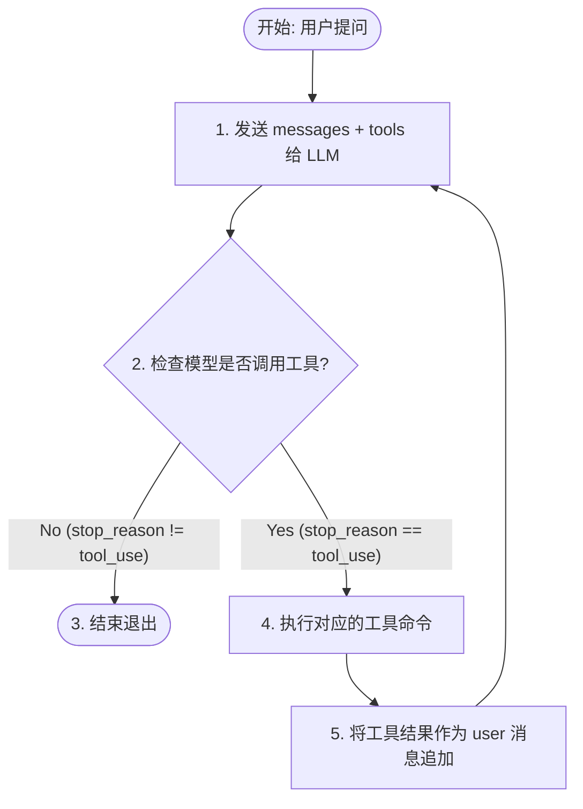

> _没有循环，就没有 agent。_
>
> 这一章先教你做出一个最小但正确的循环，再告诉你为什么后面还需要更完整的控制平面。

## 这一章要解决什么问题

语言模型本身只会"生成下一段内容"。

它不会自己：

* 打开文件
* 运行命令
* 观察报错
* 把工具结果再接着用于下一步推理

如果没有一层代码在中间反复做这件事：

```
发请求给模型
-> 发现模型想调工具
-> 真的去执行工具
-> 把结果再喂回模型
-> 继续下一轮
```

那模型就只是一个"会说话的程序"，还不是一个"会干活的 agent"。

所以这一章的核心目标只有一个：

**把"模型 + 工具"连接成一个能持续推进任务的主循环。**

## 先解释几个名词

### 什么是 loop

`loop` 就是循环。

这里的意思不是"程序死循环"，而是：

> 只要任务还没做完，系统就继续重复同一套步骤。

### 什么是 turn

`turn` 可以理解成"一轮"。

最小版本里，一轮通常包含：

1. 把当前消息发给模型
2. 读取模型回复
3. 如果模型调用了工具，就执行工具
4. 把工具结果写回消息历史

然后才进入下一轮。

### 什么是 tool_result

`tool_result` 就是工具执行结果。

它不是随便打印在终端上的日志，而是：

> 要重新写回对话历史、让模型下一轮真的能看见的结果块。

### 什么是 state

`state` 是"当前运行状态"。

第一次看到这个词时，你可以先把它理解成：

> 主循环继续往下走时，需要一直带着走的那份数据。

最小版本里，最重要的状态就是：

* `messages`
* 当前是第几轮
* 这一轮结束后为什么还要继续

## 最小心智模型

先把整个 agent 想成下面这条回路：

```
user message
|
v
LLM
|
+-- 普通回答 ----------> 结束
|
+-- tool_use ----------> 执行工具
|
v
tool_result
|
v
写回 messages
|
v
下一轮继续
```

这条图里最关键的，不是"有一个 while True"。

真正关键的是这句：

**工具结果必须重新进入消息历史，成为下一轮推理的输入。**

如果少了这一步，模型就无法基于真实观察继续工作。

## 关键数据结构

### 1. Message

最小教学版里，可以先把消息理解成：

```
{"role": "user", "content": "..."}
{"role": "assistant", "content": [...]}
```

这里最重要的不是字段名字，而是你要记住：

**消息历史不是聊天记录展示层，而是模型下一轮要读的工作上下文。**

### 2. Tool Result Block

当工具执行完后，你要把它包装回消息流：

```
{
  "type": "tool_result",
  "tool_use_id": "...",
  "content": "...",
}
```

`tool_use_id` 的作用很简单：

> 告诉模型"这条结果对应的是你刚才哪一次工具调用"。

### 3. LoopState

这章建议你不要只用一堆零散局部变量。

最小也应该显式收拢出一个循环状态：

```
state = {
  "messages": [...],
  "turn_count": 1,
  "transition_reason": None,
}
```

这里的 `transition_reason` 先只需要理解成：

> 这一轮结束后，为什么要继续下一轮。

最小教学版只用一种原因就够了：`"tool_result"`

也就是：因为刚执行完工具，所以要继续。

## 最小实现

### 第一步：准备初始消息

```
messages = [{"role": "user", "content": query}]
```

### 第二步：调用模型

```
response = client.messages.create(
    model=MODEL,
    system=SYSTEM,
    messages=messages,
    tools=TOOLS,
    max_tokens=8000,
)
```

### 第三步：追加 assistant 回复

```
messages.append({"role": "assistant", "content": response.content})
```

这一步非常重要。很多初学者会只关心"最后有没有答案"，忽略把 assistant 回复本身写回历史。这样一来，下一轮上下文就会断掉。

### 第四步：如果模型调用了工具，就执行

```
results = []
for block in response.content:
    if block.type == "tool_use":
        output = run_bash(block.input["command"])
        results.append({
            "type": "tool_result",
            "tool_use_id": block.id,
            "content": output,
        })
```

### 第五步：把工具结果作为新消息写回去

```
messages.append({"role": "user", "content": results})
```

然后下一轮重新发给模型。

### 组合成一个完整循环

```python
def agent_loop(state):
    while True:
        response = client.messages.create(
            model=MODEL,
            system=SYSTEM,
            messages=state["messages"],
            tools=TOOLS,
            max_tokens=8000,
        )
        state["messages"].append({
            "role": "assistant",
            "content": response.content,
        })
        if response.stop_reason != "tool_use":
            state["transition_reason"] = None
            return
        results = []
        for block in response.content:
            if block.type == "tool_use":
                output = run_tool(block)
                results.append({
                    "type": "tool_result",
                    "tool_use_id": block.id,
                    "content": output,
                })
        state["messages"].append({"role": "user", "content": results})
        state["turn_count"] += 1
        state["transition_reason"] = "tool_result"
```

这就是最小 agent loop。

## 它如何接进整个系统

从现在开始，后面所有章节本质上都在做同一件事：

**往这个循环里增加新的状态、新的分支判断和新的执行能力。**

例如：

* `s02` 往里面接工具路由
* `s03` 往里面接规划状态
* `s06` 往里面接上下文压缩
* `s07` 往里面接权限判断
* `s11` 往里面接错误恢复

所以请把这一章牢牢记成一句话：

> agent 的核心不是"模型很聪明"，而是"系统持续把现实结果喂回模型"。

## 为什么教学版先接受 `stop_reason == "tool_use"` 这个简化

这一章里，我们先用：

```
if response.stop_reason != "tool_use":
    return
```

这完全合理。因为初学者在第一章真正要学会的，不是所有复杂边界，而是：

1. assistant 回复要写回历史
2. tool_result 要写回历史
3. 主循环要持续推进

更完整的系统不会只依赖 `stop_reason`，还会自己维护更明确的续行状态。这是后面要补的。

## 初学者最容易犯的错

### 1. 把工具结果打印出来，但不写回 `messages`

模型下一轮根本看不到真实执行结果。

### 2. 只保存用户消息，不保存 assistant 消息

上下文会断层，模型会越来越不像"接着刚才做"。

### 3. 不给工具结果绑定 `tool_use_id`

模型会分不清哪条结果对应哪次调用。

### 4. 一上来就把流式、并发、恢复、压缩全塞进第一章

这会让主线变得非常难学。第一章最重要的是先把最小回路搭起来。

### 5. 以为 `messages` 只是聊天展示

不是。在 agent 里，`messages` 更像"下一轮工作输入"。

## 教学边界

这一章只需要先讲透一件事：

**Agent 之所以从"会说"变成"会做"，是因为模型输出能走到工具，工具结果又能回到下一轮模型输入。**

如果读者已经能凭记忆写出 `messages -> model -> tool_result -> next turn` 这条回路，这一章就已经达标了。

## 一句话记住

**Agent Loop 的本质，是把"模型的动作意图"变成"真实执行结果"，再把结果送回模型继续推理。**


---

# 新版 Agent 循环

根据 [Learn Claude Code](https://learn.shareai.run/zh/s01/) 的核心架构设计，**Agent Loop（智能体循环）** 是整个系统最基础、最重要的内核。它的核心思想是 **“One Loop Is All You Need”**——只需一个核心循环，就能让静态的大模型具备持续在真实世界行动的能力。

以下是关于 Agent Loop 的详细内容提炼：

---

## 1. 核心痛点与解决方案

* **痛点：** 单纯调用大模型时，模型即使输出了正确的指令（如 Bash 命令），它也无法自己执行，更无法看到执行结果后继续推理。人类必须手动充当“中间层”（复制命令 $\rightarrow$ 运行 $\rightarrow$ 粘贴结果 $\rightarrow$ 再提问）。
* **解决方案：** 用一个自动化的 `while True` 循环接管这个过程。模型负责**决策**（要不要用工具、用什么工具），而代码框架（Harness 层）负责**执行**（替模型跑命令、把结果喂回给模型）。

---

## 2. 最小运行内核（Minimal Harness）

整个 Agent 循环的底层运转逻辑非常纯粹，只需要 5 个步骤：



### 核心代码逻辑（约 30 行）

```python
def agent_loop(messages):
    while True:
        # 1. 投喂当前上下文与工具定义
        response = client.messages.create(
            model=MODEL, system=SYSTEM, messages=messages, tools=TOOLS
        )
        # 2. 记录 Assistant 的回答
        messages.append({"role": "assistant", "content": response.content})
        
        # 3. 检查退出条件：模型说“做完了”（不再需要工具）就退出
        if response.stop_reason != "tool_use":
            return
            
        # 4. 遍历并执行工具（例如运行 Bash）
        results = []
        for block in response.content:
            if block.type == "tool_use":
                output = run_bash(block.input["command"])
                results.append({
                    "type": "tool_result",
                    "tool_use_id": block.id,
                    "content": output,
                })
        
        # 5. 把工具结果塞回上下文，开启下一轮循环
        messages.append({"role": "user", "content": results})

```

---

## 3. 教学版 vs. Claude Code 生产级的差异

虽然底层核心都是上述的 `while` 循环，但 Claude Code 源码（`src/query.ts`）为了应对复杂的工业级场景，做了大量的安全保护与升级：

### ① 循环触发机制不同

* **教学版：** 依赖 API 返回的 `stop_reason === "tool_use"` 来判断是否继续。
* **生产级：** 在流式传输（Streaming）响应中，`stop_reason` 往往不可靠。Claude Code 采用了 `needsFollowUp` 标志位，**只要在流式文本中检测到 `tool_use` 块，就立刻将该标志设为 `true**`，确保循环继续。

### ② 状态管理（State 对象）更加复杂

教学版只维护了一个 `messages[]` 数组，而 Claude Code 的 State 包含了 **10 个核心字段**用于追踪状态，例如：

* `toolUseContext`：处理工具权限与信号。
* `autoCompactTracking` & `hasAttemptedReactiveCompact`：用于上下文爆满时的[自动压缩](https://learn.shareai.run/zh/s08)与重试。
* `maxOutputTokensRecoveryCount` & `maxOutputTokensOverride`：处理 Token 超限时的恢复策略（如自动将 8K 限制升级至 64K 覆盖）。
* `turnCount`：轮次计数，防止陷入死循环（`maxTurns` 保护）。

### ③ 流式工具并行执行

Claude Code 引入了 `StreamingToolExecutor`。当模型还在一行行流式输出命令时，只要该工具被评估为“并发安全（concurrency-safe）”，系统就会**在模型生成的同时开始异步并行执行工具**，无需等待整条消息生成完毕，极大提升了响应速度。

### ④ 多路由退出与保护机制

生产级循环不仅有“任务完成”这一条退出路径，还增加了诸如：费用超限（Budget Limit）、Prompt 过长、模型报错、用户强行中止（Abort）、钩子拦截（Hook Stop）以及结构化输出验证失败等多种兜底恢复策略。

---

> **核心总结：** > 无论上层扩展多么复杂（无论是多 Agent 协作、上下文压缩还是并发调度），整个 Agent 系统的基石始终是这个 **“大模型决策 $\rightarrow$ 框架执行工具 $\rightarrow$ 结果喂回上下文”** 的闭环。先理解了这个核心循环，后面的一切机制才能自然展开。