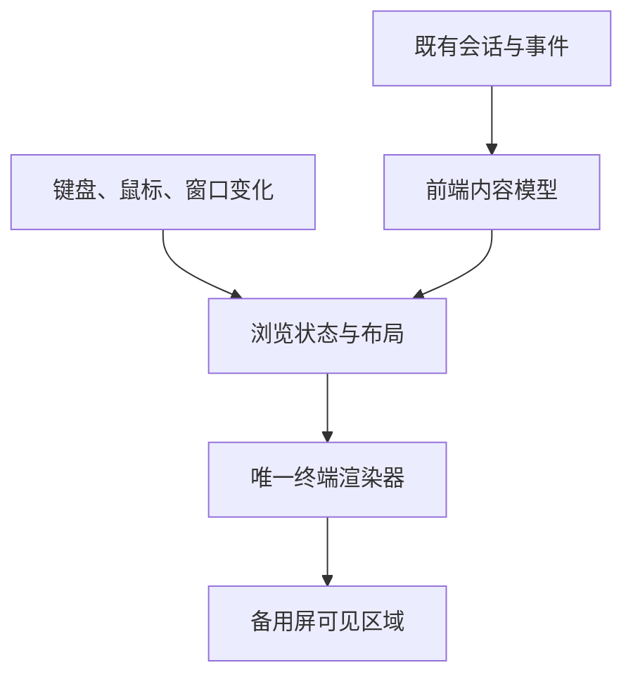

# 方案 A：备用屏与应用内历史浏览

参考 Claude Code 全屏模式，面向 DeepSeek Harness CLI 的架构原理说明。

日期：2026-09-18。本文解释方案怎样工作，不新增实施授权。已读取项目现有的 `2026-09-18-cli-fullscreen-rendering-design.md` 和 `2026-09-18-cli-fullscreen-render-acceptance-gate(1).md`：它们已选定全屏方向，冻结验收要求。本文是配套的通俗说明；正式范围、迁移和验收仍以这两份文件为准。具体代码由本地 Agent 执行，本轮没有重新运行项目实测。

## 1. 方案决定了什么

**交互界面独占备用屏。聊天记录保存在既有会话和前端内容模型中，屏幕只画用户正在看的部分。** 窗口缩放时重新排版可见内容，不把旧界面追加进主终端历史。

Claude Code 官方全屏模式采用备用屏、可见消息渲染和应用内滚动。这里借鉴它的分工，不假定能复制其内部实现，也不要求重写整个 CLI。[^1]

本项目优先复用 React/Ink 组件、会话控制器、问题卡、审批和消息展示。修改集中在前端的屏幕管理、列表布局和历史浏览；不改变 Core、Session、Event 或工具协议。

本次故障是：一条提问收到 401 后，反复缩放使提问、错误、输入框和状态栏整块重复。鉴权失败与显示错误分开处理。项目现有设计把显示故障定位为：Ink 按旧帧行数回退擦除，而终端缩放已经改变这些行的位置，因而擦错地方、留下副本。本文沿用这项有实验记录的定位；它不表示备用屏能修复重复业务事件。

## 2. 第一性原理：为什么这条路能减少复杂度

终端保存的是字符格和光标位置，不认识“消息组件”或“输入框”。在主屏中，写出窗口顶部的行会进入滚动历史，普通光标操作无法回到那里逐行修改。

备用屏是一块与主屏分开的画布，尺寸就是当前窗口大小，没有自己的原生滚动历史。程序可以重新画这块画布，退出时回到原来的主屏。[^2]

因此，复杂度发生了转移：

| 不再需要承担的工作 | 需要承担的新工作 |
|---|---|
| 追踪旧输入框是否被挤进主屏历史 | 根据窗口大小安排聊天区和输入区 |
| 尝试擦除已经离开可见窗口的旧 UI | 在应用中维护滚动位置 |
| 为重新排版而清空主屏历史 | 提供应用内翻页，保留当前画面的选择复制 |

**数据与画面必须分开。** 删除一帧、裁掉不可见行、切到 `/trace`，都只能改变显示，不能删除会话消息。备用屏本身也不保存聊天；保存仍由既有会话机制负责。

这不是只加一个切屏开关就完成。把整段长聊天原样输出到备用屏，仍会溢出、裁掉内容或破坏布局。必须同时建立受窗口限制的可见区域。

## 3. 明确的体验契约

以下行为与项目现有全屏设计保持一致。

| 场景 | 规定行为 |
|---|---|
| 启动 | 进入备用屏；不清除或重放启动前的 shell 历史 |
| 正常对话 | 聊天区可滚动，输入区和状态栏留在底部 |
| 阅读历史 | 首版使用 PgUp/PgDn/Home/End；离开底部后暂停自动跟随，新消息不得抢走阅读位置 |
| 返回最新 | End 或翻页到达底部后恢复自动跟随 |
| 搜索与滚轮 | 全文搜索、鼠标滚轮浏览不是首版要求；以后增加时由应用实现，不能假定原生滚动历史仍保存聊天 |
| 选择复制 | 保留 Windows Terminal 对当前可见文字的原生选择复制；不承诺一次选择屏幕外的全部历史 |
| 退出 | 恢复原来的主屏；本次对话通过既有会话保存和恢复机制保留，不自动打印整段对话到 shell |
| 非交互输出 | 沿用普通文本输出，不进入备用屏、不启用鼠标捕获 |

“可见消息少”只代表绘制量受控，不代表整个进程内存恒定。长会话的数据、解析结果和索引仍需存放；历史画面不必全部挂成 React 组件。

## 4. 架构与状态归属

这里的名称表示职责，不要求为每项新建一个类或文件。

| 状态 | 保存什么 | 谁可以修改 |
|---|---|---|
| 业务会话 | 消息、工具、取消等既有事实 | 既有 Core 和控制器 |
| 前端内容模型 | 消息的稳定身份、正文、展示状态及版本 | 既有前端事件适配层 |
| 浏览状态 | 当前视图、阅读锚点、是否跟随底部 | 前端输入与导航逻辑 |
| 输入状态 | 草稿、光标、焦点、卡片选择 | 既有输入与卡片逻辑 |
| 布局缓存 | 某个宽度下的换行、行数和可见范围 | 布局层，可随时失效重算 |
| 终端状态 | 当前尺寸、上一帧、光标、屏幕与输入模式 | 唯一渲染器及其生命周期管理者 |

同一条消息的流式更新必须保留同一身份。不能用“文本相同”去重：用户可以合法地发送两条一样的消息。错误消息也要有稳定的前端身份，缩放不能创建新的错误记录。

终端原始输出只能有一个入口。工具进度、错误和诊断不能直接穿插写入当前画面：可见内容进入前端模型；日志进入既有日志通道。标准错误与标准输出连接同一个终端时，也必须遵守这一规则。

## 5. 如何只画看得见的内容

### 5.1 先分配空间

整帧高度等于窗口行数。自上而下分成历史窗口、弹性留白、活动区、底部区：活动区放流式正文、待完成工具和工作状态；底部区放输入框、状态栏和交互卡。卡片实际归属沿用组件结构，同一内容不能重复计入两个区域。

可用历史行数＝max(0，窗口行数－实测活动区高度－实测底部区高度－必要的安全行)。高度必须随本帧内容重新测量，不能只扣一个固定常数。流式正文增长、问题卡变高也会改变预算。弹性留白吸收剩余空间，让底部区留在窗口底边。

输入很长或问题卡很高时，对应区域在自身范围内滚动。先收起装饰和非必要帮助，保持关键操作可达。窗口小到不能同时显示正常布局时，进入紧凑显示，保留草稿、焦点和当前选择；恢复尺寸后还原。不得用输出超过窗口高度的内容来“撑开”布局。

渲染内容必须按终端字符格计宽：中文、emoji 和组合字符不能直接按字符串长度算。换行、裁切和光标定位使用同一套宽度规则；不能截断一个完整字符。正文的原始换行保留，视觉软换行只属于布局。原生选择复制另在真实 WT 验证。

### 5.2 再选可见行

根据消息身份、内容版本和可用宽度，缓存每个内容块的展示行数。由累计行数找到阅读位置，只生成窗口可见的行和有限的邻近内容。

单条消息也可能有几千行，所以不能只做“消息级筛选”后把整条巨型消息交给终端。巨型内容块也必须按行范围生成可见片段。相邻少量预排版可以用于平滑滚动，但不允许每次都挂载全部历史。

所有消息仍在内容模型或既有会话存储中；“没有绘制”不等于“被删除”。布局缓存可以淘汰，业务记录不能因此淘汰。全屏路径不再使用 `<Static>` 追加历史，也不维护“哪些块已经打印到主屏”的账本。历史翻页复用现有 Trace 的滚动状态模型。

### 5.3 用内容位置保存阅读进度

滚动位置保存为“内容块身份＋块内文本位置”，而不是旧窗口里的绝对行号。缩放后先重新换行，再找回这个内容位置。

用户正在看第 20 条消息的某段文字时，窗口变窄后仍从该段附近显示。用户处于跟随底部状态时，则始终显示最新内容。草稿和卡片选择独立于绘制组件保存，组件重新排版不能重置它们。

## 6. 更新与缩放怎样执行

正常更新遵循一个顺序：事件更新前端模型 → 请求绘制 → 取本帧尺寸 → 生成可见布局 → 由渲染器提交。

同一消息的多个流式片段可以合并成一次绘制；每个业务事件仍照常处理。减少绘制次数不能合并掉消息或取消事件。

一次缩放按以下步骤处理：

1. 进入统一的修复窗口，阻止旧布局继续提交。标记旧布局和上一帧比较基准失效，保留内容模型、阅读锚点和草稿。
2. 连续尺寸事件合并，绘制前重新读取真实尺寸，不直接相信排队中的旧尺寸。
3. 用新宽度换行，重新分配各区域，并恢复阅读锚点或底部跟随位置。
4. 在统一写入控制下清除备用屏可见区域，将光标放到已知起点，再要求 Ink 完整重画。清除、起点、全量重画按顺序执行，中途不夹入旧帧输出。
5. 绘制期间又发生缩放时，将该帧标为过期并安排最新尺寸的完整刷新；旧布局不能成为后续增量绘制的基准。

普通帧仍由现有 Ink 渲染；本方案不新造字符格差分渲染器。协调层通过一个明确的“强制完整重画”接口让 Ink 忘掉旧帧，不能只清屏却让 Ink 误以为旧内容还在。这个接口不应通过切换备用屏或反复切 raw mode 来实现。

修复时业务事件照常应用，暂缓的是画面提交。期间输入必须完整交付；框架的光标查询响应不能混进用户输入。短暂空白可接受，旧帧与新帧混在一起不可接受，包括拖动尚未结束时。项目现有设计接受约 60–120 ms 的修复空白；具体清除次数和等待时间交给 Agent 用证据确定。

对终端支持的同步输出能力，可以把一次更新包起来，让用户尽量只看到完整帧。它减少闪烁，不修复算错位置、重复事件或多处同时写终端的问题。

## 7. `/trace`、外部程序与退出

### 7.1 屏幕只有一个主人

备用屏不是可任意嵌套的窗口栈。主界面已经在备用屏时，`/trace` 应切换应用内视图，保存原先的草稿、焦点和阅读位置；关闭 Trace 后恢复这些状态并重画。

Trace 子组件不能自行发送进入或离开备用屏的指令。主界面和 Trace 都在同一个 Ink 根中切换内容；会话只在主 UI 挂载时进入一次备用屏，在退出时恢复一次主屏。原 Trace host 的手动切屏路径退出使用。

普通工具输出进入现有展示和日志通道，不交出屏幕。若调查发现必须直接控制终端的交互式子程序，Agent 应单列交接设计，与“全会话只切屏一次”的既有约定核对；本方案不擅自新增该例外。

### 7.2 所有退出路径执行同一份恢复工作

正常退出、Ctrl+C、异常和现有强制兜底都要覆盖以下顺序：停止新绘制 → 结束输入捕获 → 恢复光标及终端模式 → 离开备用屏 → 输出必要的退出信息 → 结束进程。

恢复操作只能由生命周期所有者执行一次，重复调用应直接返回。不能只依赖 React 组件卸载，因为强制退出可能跳过卸载。现有 2 秒兜底需要有可同步执行的最小恢复路径，包含退出备用屏、显示光标和关闭括号粘贴，并保留直接触发标记；它仍是强制退出，不能改称自然退出。

会话落盘继续遵守既有保存机制。终端恢复成功不能作为消息已经保存的证据，两项分别验证。进程遭到操作系统强制终止或终端本身关闭时，不承诺程序还能执行清理。

## 8. 如何落到本项目

| 优先复用 | 必须调整 |
|---|---|
| 会话、消息与工具事件接线 | 历史由主屏追加输出改为应用内可见范围展示 |
| Markdown、代码与工具结果展示 | 正文换行和区域裁切统一计宽 |
| 编辑器、问题卡、审批操作 | 浏览状态与草稿不能依赖组件挂载寿命 |
| 既有会话保存、恢复和日志 | 主界面、Trace、外部终端程序共用屏幕所有权 |
| 已有终端测试与真实 WT 驱动 | 原生历史断言改为应用浏览与主屏恢复断言 |

Ink 7 提供原生备用屏入口；项目现有设计也明确保留 Ink，使用其备用屏能力，并补一个窄范围的强制完整重画接口。Agent 按当前锁文件、vendor 和原型核对具体接法，不能直接认为一个参数就能适配现有实现。[^3]

迁移沿用正式设计的四阶段：先由 `DSH_CLI_FULLSCREEN=1` 启用，默认主屏保持原样；完整门禁及历史浏览通过后再切默认；保留一轮真实使用与 CI 观察期的 `DSH_CLI_FULLSCREEN=0` 退路；观察期结束后单独删除旧主屏修复和开关。两套路径只在过渡期间并存，不在本说明中提前删除旧路径或永久维护双模式。

## 9. 怎样证明方案可行

先用用户当前入口记录一次真实失败，再用相同内容和终端验证原型。所有探针只调用正常的消息与错误展示链；H001–H100 不能用 CLI 启动前的 shell 输出代替。

| 场景 | 必须看到的结果 |
|---|---|
| 一条提问＋确定性的 401 错误 | 前端记录各一条；反复缩放后应用内仍各一条，只有一个输入区和状态栏 |
| 正常消息链产生 H001–H100 | 使用首版历史键翻看，全部完整、有序、各一次；长消息中段也可到达 |
| 连续宽高变化 | 慢拖、快速往返、缩放风暴，覆盖仅高度变化和超过 120 列的路径截断阈值；拖动中及落定后都没有混合帧 |
| 中文、emoji、长路径与多行草稿 | 无半个字符、错位光标或内容丢失；窄时截断、宽时恢复，原生选择复制正常 |
| 阅读旧消息时继续流式输出 | 不被拉回底部；手动回到最新后恢复跟随 |
| 问题卡 → Esc → 取消回执 → 同会话续聊 | 操作只提交一次，焦点和状态正确，没有旧卡片残留 |
| 进入并退出 Trace，期间缩放 | 留在应用备用屏；返回后草稿、焦点和阅读位置恢复 |
| 正常退出及强制兜底 | 回到原 shell；光标、输入和粘贴正常；会话保存另有证据 |
| 长历史的持续绘制 | 实际挂载和绘制的历史范围随窗口约束，不随全部消息数线性增加 |

这张表补充原理对应的检查，不替换既有门禁。正式实施仍完整继承十一项不变量、L1/L2/L3 和真实 WT 场景矩阵，包括输入完整性、默认路径安全、会话切换及审批卡。全套命令和 flaky 的 change/base 裁决按门禁原文执行。

真实 WT 像素裁决视觉问题，PTY 字节裁决切屏顺序和输入交付，UIA 计数只作辅助。原始字节出现多次相同文本可能只是正常重绘，不能直接当成重复显示。项目文档记录了原型验证，不等于正式构建已验收；其他终端也不能沿用 WT 的支持结论。

## 10. 实施前提与 Agent 自主空间

现有项目设计已经选择这条路线；本文不重开选型。正式切换默认前必须满足既有设计的条件：

1. 首版历史浏览已经可用，当前画面的原生选择复制通过验证；不要求先实现搜索或滚轮。
2. 正式构建通过全部门禁和真实 WT 场景，不能以原型记录代替。
3. 默认切换、短期退路和旧路径退役各自有规定的证据与记录。

Agent 自行确定文件拆分、缓存结构、库调用和现有交互的接法。历史键、消息保存、取消语义、MVP 范围和验收契约不能擅自改变。若实现遇到冲突，应提交事实和失败证据，而不是删除对应验收。

**这条路线的关键是：所有会变化的画面都留在一块能完整擦干净的屏幕里。历史由应用保存和翻页，缩放只需要清除这块屏幕，再画一份。**

## 相关笔记

- [[wiki/CLI渲染方案B-主屏混合|方案 B：主屏聊天与备用屏查看器]] — 保留供比较的备选设计；本项目已选定方案 A
- [[wiki/inline-grid-footer-render|Inline Grid Footer 渲染架构]] — 同类 resize 堆叠问题在 inline 模式下的 cell 级双缓冲解法
- [[wiki/terminal-inline-renderer-principles|Terminal Inline Renderer 架构原则]] — DECAWM、计宽、ANSI 处理等底层不变约束
- [[wiki/mi-code-tui-experience|MiCode TUI 开发经验汇总]] — 从 Ink/React 迁移到自研差量渲染的实战记录

## 引用索引

[^1]: [Claude Code 全屏模式官方说明](https://code.claude.com/docs/en/fullscreen) — 备用屏、可见消息渲染与应用内滚动的官方行为描述
[^2]: [Microsoft 虚拟终端序列：备用屏缓冲区](https://learn.microsoft.com/en-us/windows/console/console-virtual-terminal-sequences#alternate-screen-buffer) — 备用屏画布与主屏分离的终端控制序列定义
[^3]: [Ink v7.0.0 发布说明](https://github.com/vadimdemedes/ink/releases/tag/v7.0.0) — Ink 7 提供原生备用屏入口
