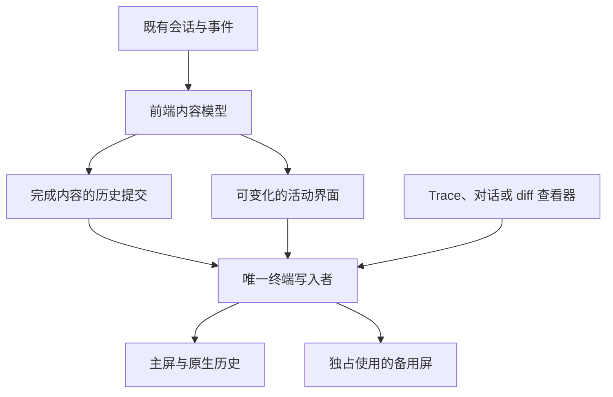

# 方案 B：主屏聊天与备用屏查看器

参考 Codex CLI 的混合方式，面向 DeepSeek Harness CLI 的候选架构设计。

日期：2026-09-18。状态：保留供比较的备选设计，本轮没有运行本项目原型或批准实施。Codex 参考源码固定在 `7498521d288b9b3b96ffba4eedf089d8d6e06a84`；本文是面向本项目的设计，不是对 Codex 全部行为的保证。已读项目现有全屏设计和验收门禁，它们已选择方案 A；本文不推翻该决定，也不要求并行实现方案 B。

## 1. 方案决定了什么

**完成的内容写入主终端原生历史，正在变化的界面留在可见窗口内；查看完整对话、Trace 或 diff 时，独占使用备用屏。** 前端始终保留足以重建当前会话显示的内容模型。

Codex 使用 Rust、Ratatui、Crossterm 和定制终端层。其源码明确将完成内容插入终端历史，并在查看器等场景切换备用屏。框架和屏幕模式是两个不同选择，本项目可以在现有 TypeScript/React 边界内实现同样的职责分工，不默认迁移语言。[^2][^3][^4]

**本候选有一个必须接受的代价：需要重建时，允许清空终端滚动区和可见画面，再由当前会话模型重放内容。启动前的 shell 历史可能因此消失。** 会话数据仍保存在原来的存储中，两者不是一回事。

如果“任何缩放都不得清除启动前的 shell 历史”仍是硬要求，本候选不能直接采用。应继续验证更小的主屏修复或选择方案 A，不能把保留全部 shell 历史写成未经证明的能力。

## 2. 第一性原理：困难来自哪里

主屏有两个区域：当前可见的字符格，以及已经滚到上方的历史。程序能用普通终端控制序列修改可见区域，不能像编辑数组那样随机改写上方历史。[^1]

因此，必须分开两种内容：

| 内容 | 能否继续变化 | 放在哪里 |
|---|---|---|
| 已提交的用户消息、已完成回复、已确定的错误或工具回执 | 本方案中视为已经完成 | 主屏历史 |
| 流式回复、输入框、状态栏、待回答问题卡 | 会变化 | 受窗口限制的活动区域 |

窗口缩小时，终端可能先重新换行或把旧活动区域挤进历史，然后才通知程序。即使程序每帧都算对当前行数，也无法据此保证已经进入历史的旧 UI 能被擦回。

所以本方案使用两条不同的更新路径：

- **位置可信时，只更新变化的部分。** 保持输出少，原生历史可直接浏览和复制。
- **尺寸变化或位置失去可信度时，从内容模型重建。** 放弃修补未知旧坐标，清除旧显示，再生成一份确定的新显示。

Codex 的参考源码确有主屏清除和缩放重放路径；这里采用同一原理，并把损失 shell 历史的代价明确写成契约。[^5][^6]

## 3. 明确的体验契约

| 场景 | 规定行为 |
|---|---|
| 日常聊天 | 完成内容进入原生历史，保留终端原生浏览、搜索和选择复制的方式 |
| 正在输出的长回复 | 活动区显示可容纳的尾部；查看器可读取当前完整文本；结束后完整内容进入原生历史 |
| 输入与问题卡 | 只在活动区绘制，不作为历史内容追加；卡片结束时只追加确定回执 |
| 缩放 | 合并连续尺寸事件后重建；允许清除主屏历史，重新输出当前会话 |
| 缩放时的选择与阅读位置 | 不承诺保留终端原生选择和滚动位置；可能回到最新画面 |
| 查看器 | 备用屏中浏览完整模型；退出后返回主屏，恢复输入状态 |
| 退出 | 已完成的聊天内容留在主屏；移除或收起临时活动 UI，恢复正常 shell 输入 |
| 历史长度 | 终端最多保留自身容量允许的行；完整会话由既有存储和查看器负责 |

“每条内容只出现一次”指终端容量内应保留的可核对内容没有副本；不是声称有限终端能永久保存无限行。回归测试必须给终端设置足够容纳样本的历史容量。

本方案不同时实现另一套主聊天全屏模式。备用屏只用于明确的查看器和交接，不增加无必要的双模式配置。

## 4. 架构与状态归属

最后两条输出路径互斥，不能同时写。名称表示职责，Agent 可按项目结构合并实现。

| 状态 | 作用 |
|---|---|
| 前端内容模型 | 持有消息身份、正文、版本、完成状态；可以生成完整当前会话 |
| 历史提交位置 | 记录本轮显示中已写出的连续内容范围，避免再次追加；它不是业务落盘状态 |
| 活动帧 | 输入框、卡片、流式尾部、状态栏及它们占用的字符格 |
| 终端位置账本 | 当前尺寸、活动区起点、光标、上一帧及位置是否可信 |
| 重建批次 | 区分缩放前后的输出，阻止旧任务继续向新画面追加 |
| 查看器交接状态 | 保存主屏活动区、草稿、焦点，以及查看期间产生的待显示内容 |

所有更新首先进入内容模型。画面是模型的投影，不从抓屏文本反推业务消息，也不因重画创建新的会话事件。

错误使用稳定的前端身份；相同正文的两条合法消息不能被合并。第一次收到 401 时产生一条错误展示记录，尺寸变化不再产生第二条。

这里的“模型”是已有事件和会话在前端的显示投影，不是新增业务存储。它需要保留原始正文与稳定顺序，不能只保存旧宽度下的终端行或 ANSI 截图。

## 5. 平常怎样更新，而不留下旧输入框

### 5.1 普通活动帧

活动区的总高度不得超过窗口。先保留必要输入与状态空间，再分配流式正文和卡片的可见范围；长输入、卡片和流式内容在各自允许范围内裁切或滚动，不通过多打印几行撑开终端。极小窗口使用紧凑显示，保留内容、草稿和焦点，放大后恢复。

先在内存中排出本帧的字符格，再与上一帧比较。文字移动、缩短或消失时，原位置必须写回正确的空白和样式。中文与 emoji 占据的多个字符格一起处理，不能留下半个字符或背景色。

底部输出尤其要处理最右列自动换行及末尾换行：写出一行在视觉上看似未超宽，不代表终端没有立即滚动。由渲染器统一执行底部保护；若当前实现不能证明最右格安全，活动文本预留一列，不向窗口底部额外写换行。

这些规则必须落在实际掌管输出的渲染器里。不能一边让 Ink 按自己的位置绘制，一边用额外 ANSI 指令移动光标却不更新它的状态。

### 5.2 一条内容完成时

以流式回复结束为例：

1. 既有控制器确定该内容结束，前端模型更新为完成状态。不能用“暂时没新 token”猜测结束。
2. 按稳定显示顺序，选出尚未提交且已经连续完成的一段内容；进入独占写入过程，擦掉原活动区，包括流式尾部及临时 UI。
3. 将这一段内容从活动区原起点按顺序写出，允许正常终端滚动承接它。
4. 按新的真实位置重画输入框、状态栏等活动内容。
5. 输出成功后推进历史提交位置；若尺寸在过程中变化，或写入失败而无法确定已写出多少，整份位置账本失效，进入重建。

只有已经完成的正文和回执允许留在滚动历史。输入框、spinner、待操作卡片和旧状态栏必须在让内容上滚前移除。

用户消息在提交后可立即成为完成内容；工具进度与问题卡等待期间属于活动内容；取消或失败后，按既有业务结果形成确定回执。渲染器不能代替业务控制器决定取消是否成功。

完成顺序可能与显示顺序不同。假设 A、B、C 按顺序展示，B 尚未结束而 C 已完成，不能先把 C 打进历史、以后再追加 B；A 可以提交，B 和 C 暂留在活动模型中。未提交内容过长时显示尾部，并通过查看器浏览完整文本。这条规则保证历史顺序与内容模型一致。

一旦提交，显示块在本轮终端历史中就视为不可修改。若迟到事件确实改动了它的正文或显示顺序，应从模型完整重建，不能假装还能回到滚动区原位编辑。无关的 spinner 或持续变化状态不应塞进已经完成的块。

历史插入必须通过同一写入者。采用整屏滚动还是局部滚动区域，由 Agent 用真实 WT 验证决定；不能默认局部滚动区域在所有终端都会产生相同的原生历史。

## 6. 缩放后的确定性重建

这是本方案恢复位置可信度的核心流程。

1. **暂停旧显示提交。** Core 可以继续工作，消息和输入继续进入模型；暂停的是向终端提交旧坐标画面。
2. **合并尺寸变化。** 绘制前读取实际行列。连续拖动可以延迟重建，但最后一次变化后必须主动安排刷新，不能等下一次按键才恢复。
3. **取得模型快照。** 记录本次重建包含到哪条事件、哪些内容已完成，以及草稿、焦点和活动内容。
4. **清除旧显示。** 在主屏中恢复完整滚动区域，清除可见画面和滚动区，回到已知光标起点；此前 shell 历史也可能被清除。这一操作在采用方案前必须获得契约确认。
5. **从正文重新排版。** 按新宽度生成完成内容；不复用旧宽度下的行，也不把上一帧截图当作输入。
6. **顺序重放并控制输出速度。** 完成内容写在前面，活动区最后只画一份。长会话分批输出，并尊重输出流的接收速度，避免一次堆入大量数据。
7. **处理重建期间的新尺寸。** 已写出的字节不能撤回；发现再次缩放时停止旧批次后续输出，按最新尺寸重新清除和重建。旧批次不得继续推进新批次的历史提交位置。
8. **建立新基准。** 尺寸未再次失效且输出完成后，更新活动区位置和上一帧；再显示快照之后收到的新内容。已经重放的内容不得再次作为“新消息”追加。

终端写入完成只表示数据已交给输出通道，不证明物理屏幕每个字符都正确。真实 WT 画面仍是必要验收证据。

初次接管终端时也需要可信尺寸与光标锚点。优先复用框架现有探测；探测失败时，在本方案允许的清除契约下建立干净起点，不猜测原位置。若库使用光标位置查询，其响应必须由查询逻辑消费，不能漏进用户输入。

同步输出协议可以减少用户看到半帧的机会，但不能使一长段历史重放必然原子完成，也不能恢复被清除的 shell 历史。长历史重建的闪烁和耗时需要实际测量。

这能提供明确的恢复路径，但不自动证明拖动过程也没有重影：终端可能在应用收到尺寸通知前就移动旧活动帧。若真实 WT 的拖动中画面仍有旧输入框副本，本方案就未满足本项目的视觉目标；不能把“松手后清干净了”当作通过。

## 7. 查看器如何切到备用屏

主聊天、Trace、对话查看器和 diff 共用同一屏幕所有者。打开查看器时：

1. 暂停主屏写入，完成或中止当前受控输出，保存草稿、焦点和活动区状态。
2. 进入备用屏，由查看器独占显示与输入。
3. 业务事件照常更新模型；期间完成的新内容先不写到隐藏的主屏。
4. 关闭查看器，退出备用屏并重新读取尺寸。
5. 主屏位置仍可信时，补交待显示的完成内容并重画活动区；查看期间发生过缩放或其他破坏位置的操作时，执行完整重建。

如果在查看器里再打开一个子视图，只更换应用内视图，不重复进入物理备用屏。备用屏不是多层窗口栈。

外部交互程序也通过同一个所有者交接终端。任何直接写终端的第三方输出都会破坏位置账本，因此工具 stdout/stderr 应先进入现有展示或日志通道，不能绕过协调直接穿插。

## 8. 退出与保存

正常退出时，先按既有机制完成必要保存，再收起活动 UI，解除输入模式、恢复光标与滚动区域；如果仍处于查看器中，先离开备用屏。主屏中的完成内容继续保留。

Ctrl+C、异常和现有强制兜底共享同一份可重复调用的终端恢复逻辑。强制路径不能依赖异步组件卸载才恢复光标和备用屏。现有 2 秒兜底的触发与会话保存结果分别记录，不能因进程退出就宣称正常排空。

本路线只改变显示模型和终端管理，不新增 Core 事件，也不重写会话存储。重建可以多次输出相同正文，但不允许多次提交用户消息、回答问题卡或执行工具。

## 9. 如何落到本项目

优先检查当前 Ink/vendor 层能否完整承担位置账本、历史插入、画面失效和重建。业务 UI 组件能否复用，要以它们能否生成确定的布局和字符宽度为准。

| 可复用部分 | 必须拥有的能力 |
|---|---|
| 会话控制、消息与工具展示 | 可从语义模型重新生成整段当前会话 |
| 编辑器、问题卡和取消流程 | 草稿与焦点不因重建丢失 |
| 既有 Trace/查看器 | 统一屏幕与输入所有权 |
| Ink 或现有终端封装 | 可控制实际写入、完整失效旧帧，并建立新光标基准 |
| 既有终端测试 | 同时验证原生历史与活动帧，不能只检查最后一屏 |

如果现有框架只能暴露高层组件，无法可靠控制上述过程，继续在外部堆补丁可能比更换后端更贵。Agent 应指出缺少的具体能力和最小改造范围，再由选型决定是否接受。

Ratatui 的使用本身不会自动提供本项目需要的主屏历史策略。直接迁移 Rust 还会引入语言边界和前端重写，不属于本候选默认动作。

## 10. 怎样证明方案可行

先在相同启动入口和真实 WT 中记录现有失败；修复或原型必须让同一个失败样本通过。用正常消息和错误路径产生内容，不用启动前的 shell echo 冒充 CLI 消息。

| 场景 | 必须看到的结果 |
|---|---|
| 提问＋模拟 401，反复缩放 | 对应记录各一条；终端保留的聊天各一份，输入区与状态栏各一份 |
| CLI 输出 H001–H100 | 在容量足够的主屏历史与视口合并检查，完整、有序、各一次 |
| 慢拖、快速往返、缩放风暴及宽度阈值 | 120×40、100×30、80×20 往返并覆盖超过 120 列；拖动中与落定后都无旧输入框副本、无混合帧；尺寸稳定后主动重建 |
| 重建途中继续接收消息或再次缩放 | 新内容不丢、不乱序，旧批次不会追加到新画面 |
| 流式正文从活动区转为完成历史 | 不同时留下流式尾部和完整正文的重复副本 |
| 多个展示块乱序完成 | 只提交连续完成的范围；最终显示顺序与模型相同，没有遗漏或副本 |
| 中文、emoji、长错误与多行草稿 | 字符完整，输入与卡片状态保留，底部没有额外滚动产生的旧框 |
| 卡片取消后续聊 | 取消回执和后续消息各处理一次，焦点正常 |
| 查看器中缩放后返回 | 正确选择重建路径，没有两个输出者，也不泄漏查询响应到输入 |
| 主屏既有标记在重建后消失 | 明确记录为本方案代价，不能写成“全部历史保留通过” |
| 退出与强制兜底 | shell 输入、光标、粘贴正常；会话持久化另外核对 |

测试同时采集模型中的消息身份、原始输出和真实画面。普通重绘本来可能多次发出同一段字节，判重应针对显示结果和语义记录。回放或 UIA 结果与肉眼矛盾时，保留分歧并补实屏证据，不降低验收标准。

## 11. 采用条件与 Agent 自主空间

采用前必须同时确认：

1. 接受缩放重建可能清除启动前 shell 历史，并可能打断终端原生选择或阅读位置。
2. 项目拥有足以重建当前会话的前端内容模型，不需要重造 Core 或存储。
3. 现有框架能统一历史输出和活动帧，或其改造代价已经明确。
4. 真实 WT 原型通过快速缩放、消息并发、卡片、查看器和退出验证。

项目当前冻结的门禁规定了全屏、单次切屏和应用内历史。方案 B 天然不符合这些架构条款，因此只有正式变更架构决定及相应验收契约后才可能实施；不能拿方案 A 的通过记录为它背书。无重影、无混合帧、输入完整性等共同目标仍必须保留。

Agent 自行选择缓存结构、输出批次、尺寸事件合并方式和框架接口，但不能暗中加入另一套输出者、靠清空历史冒充保留历史，或删除失败断言。

**此方案保留日常聊天的原生终端体验，代价是复杂的位置管理与重建，并明确放弃“任意缩放都保留启动前 shell 历史”的保证。若不接受这项代价，本候选不成立。**

## 相关笔记

- [[wiki/CLI渲染方案A-备用屏|方案 A：备用屏与应用内历史浏览]] — 项目已选定的方案；本文为保留供比较的备选设计
- [[wiki/inline-grid-footer-render|Inline Grid Footer 渲染架构]] — 主屏活动帧更新与 resize 失效的工程先例
- [[wiki/terminal-inline-renderer-principles|Terminal Inline Renderer 架构原则]] — 底部输出、计宽与自动换行等底层约束
- [[wiki/Agent驱动Rust学习|Agent驱动Rust学习]] — 以 Codex 源码为地图的 Coding Agent Runtime 学习路线

## 引用索引

[^1]: [Microsoft 虚拟终端序列：备用屏缓冲区](https://learn.microsoft.com/en-us/windows/console/console-virtual-terminal-sequences#alternate-screen-buffer) — 主屏可见区与滚动历史的终端能力边界
[^2]: [Codex codex-rs/tui/Cargo.toml @ 7498521d](https://github.com/openai/codex/blob/7498521d288b9b3b96ffba4eedf089d8d6e06a84/codex-rs/tui/Cargo.toml) — Rust、Ratatui、Crossterm 依赖
[^3]: [Codex codex-rs/tui/src/insert_history.rs @ 7498521d](https://github.com/openai/codex/blob/7498521d288b9b3b96ffba4eedf089d8d6e06a84/codex-rs/tui/src/insert_history.rs) — 完成内容插入终端历史的实现
[^4]: [Codex codex-rs/tui/src/tui.rs @ 7498521d](https://github.com/openai/codex/blob/7498521d288b9b3b96ffba4eedf089d8d6e06a84/codex-rs/tui/src/tui.rs) — 查看器等场景切换备用屏的屏幕管理
[^5]: [Codex codex-rs/tui/src/app/resize_reflow.rs @ 7498521d](https://github.com/openai/codex/blob/7498521d288b9b3b96ffba4eedf089d8d6e06a84/codex-rs/tui/src/app/resize_reflow.rs) — 主屏清除与缩放重放路径
[^6]: [Codex codex-rs/tui/src/custom_terminal.rs @ 7498521d](https://github.com/openai/codex/blob/7498521d288b9b3b96ffba4eedf089d8d6e06a84/codex-rs/tui/src/custom_terminal.rs) — 清除实现
