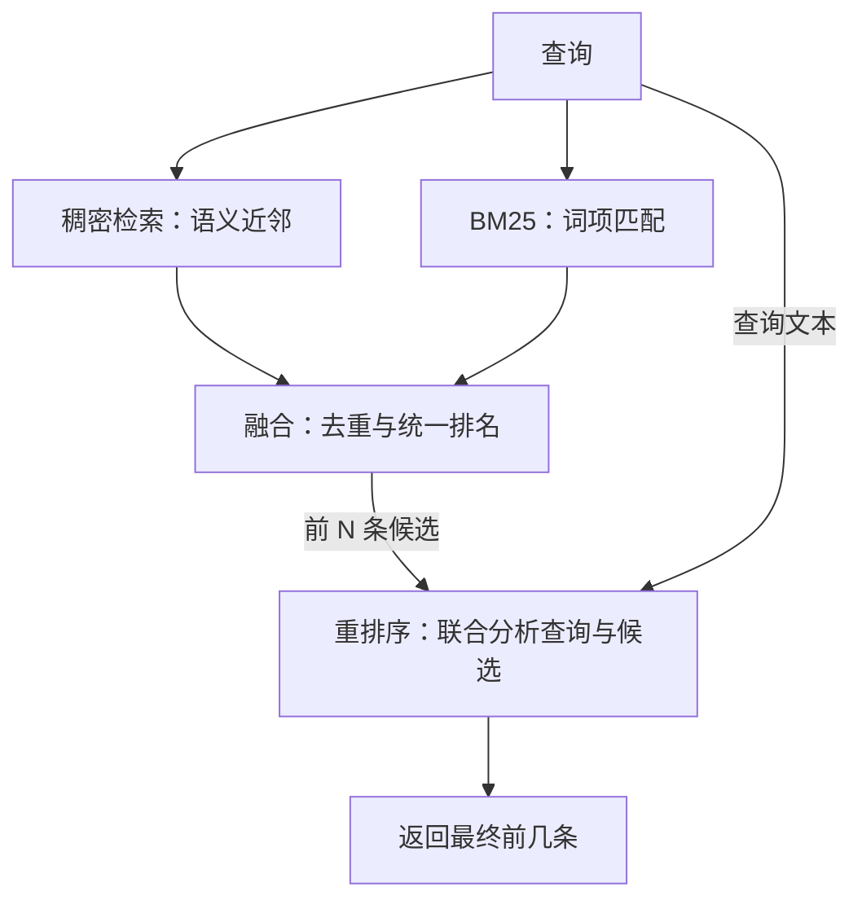

**混合检索让两种方法各找一批候选，融合形成统一排名，再用更细致的模型重新判断相关性。** 这样可以利用两种检索方法的互补能力，降低漏找风险。[^1]

例如，稠密检索可能找到与“HTTP-403”主题相近的文章，却没有优先找到讨论这个具体错误码的文档。基础 BM25 擅长匹配确切词项，但未加入同义词扩展时，查询“kitty”（小猫）难以匹配只写“cat”（猫）的文档。

**第一阶段：并行检索，扩大候选范围。** 两个引擎分别返回一批候选。这里的“召回”，就是先把可能相关的文档找出来，供后续筛选。

**第二阶段：融合两路结果。** 同一文档按标识合并，避免重复；随后生成统一排名。候选数量由重复文档数量和截断设置决定。

融合需要处理分数尺度不同的问题：余弦相似度的理论范围是 **−1 到 1**，BM25 得分则依赖语料和计算方式。不能因为 `8.4 > 0.87`，就判断前者对应的文档更相关。

**RRF，即倒数排名融合，用排名代替原始分数。** 每一路都根据文档的名次提供一份贡献，再将贡献相加：

\[
\mathrm{RRF}(d)
=
\sum_{j:\,d\in L_j}
\frac{1}{c+\mathrm{rank}_j(d)}
\]

其中，\(L_j\) 是某一路返回的列表，排名从 `1` 开始。文档未出现在某一路列表中，该路贡献为 `0`。\(c\) 是平滑常数，常取 `60`；它让靠前几个名次之间的分差变小。[Elasticsearch Reference](https://www.elastic.co/docs/reference/elasticsearch/rest-apis/reciprocal-rank-fusion?utm_source=chatgpt.com)

计算示例，非实测结果：

| 文档 | 稠密排名 | BM25 排名 | RRF，\(c=60\) |
|---|---:|---:|---:|
| A | 1 | 未召回 | \(1/61\approx0.0164\) |
| B | 3 | 2 | \(1/63+1/62\approx0.0320\) |

B 在两路中都有贡献，因此融合排名超过 A。

RRF 的便利是不用校准两路分数；代价是忽略原始分差。例如，第 1 名究竟只略胜第 2 名，还是远远胜过第 2 名，这些信息不会进入上述计算。

**第三阶段：重排序，联合读取查询与候选文档。** 它重新计算相关性，可以接在 RRF 或其他融合方法之后。

稠密检索常用**双编码器（Bi-Encoder）**：查询和文档分别生成向量，再比较向量。文档向量可以提前生成、保存并建立索引，因此适合从海量文档中快速初筛。

**跨编码器（Cross-Encoder）**把查询和一篇候选文档一起送入模型，让两者的信息在同一次计算中交互，直接输出相关性分数。查询改变后，需要重新给各候选打分，所以通常只处理几十或几百篇候选。[Sentence Transformers documentation](https://www.sbert.net/examples/sentence_transformer/applications/retrieve_rerank/README.html?utm_source=chatgpt.com)

例如，可以将融合后的前 `50` 条交给 `BAAI/bge-reranker-v2-m3`，按它输出的分数重新排序。该模型接收查询与文档，直接输出相关性得分。[Hugging Face](https://huggingface.co/BAAI/bge-reranker-v2-m3?utm_source=chatgpt.com)

这种联合判断可能改善排序，也增加计算成本。是否加入重排序，应依据实际数据上的效果、延迟和成本判断。**只有进入重排序候选集合的文档，才有机会出现在它的最终结果中。**

**评估质量，需要先给测试查询标注相关文档。** 候选是否找全，与相关文档是否排在前面，是不同问题：

| 指标 | 计算口径 | 回答的问题 |
|---|---|---|
| **Hit@k：查询命中率** | 前 k 条至少命中一篇相关文档的查询数 ÷ 查询总数 | 每个查询至少找到了一个吗？ |
| **Recall@k：文档召回率** | 每个查询在前 k 条找回的相关文档数 ÷ 全部标注相关文档数，再对查询取平均 | 该找的相关文档找回多少？ |
| **MRR：平均倒数排名** | 每个查询取第一个相关文档排名的倒数，未找到记 0，再取平均 | 第一个相关文档够靠前吗？ |
| **nDCG@k：归一化折损累积增益** | 按相关程度和位置累加贡献，再除以同一查询的理想排序得分 | 整个前 k 条列表排得好吗？ |

MRR 中，第 `1` 名贡献 `1`，第 `10` 名贡献 `0.1`。nDCG 会给较后位置更小的权重，并可使用分级相关性标注；理想排序得分为 `1`。[nlp.stanford.edu](https://nlp.stanford.edu/IR-book/html/htmledition/evaluation-of-unranked-retrieval-sets-1.html?utm_source=chatgpt.com)

原文所谓“包含正确答案的文档出现在前 k 条的查询比例”，采用的是 **Hit@k 的口径**。它与标准文档召回率需要区分。

计算示例：一个查询有 `4` 篇标注相关文档，前 `10` 条找回 `1` 篇，则该查询的 `Recall@10=25%`，但已经命中，Hit 为 `1`。只有每个查询都仅标注一篇相关文档时，两种指标才相等。按原文定义，top-20 检索失败率对应 `1−Hit@20`。

RAG 在检索之后把命中的资料交给大模型回答。命中相关资料只是给了模型利用它的机会，不能保证最终回答正确。

原文描述的 `retrieval-pipeline` 项目通过 `test_client.py` 覆盖语义相似、精确名称、多语言和技术代码等查询，并报告重排序能改善部分文档的排名。本段没有提供具体排名变化记录、标注测试集或量化指标，因此无法据此确定改善幅度，也无法证明这套组合在所有场景下都优于其他方案。

## 引用索引

[^1]: 原文：《AI Agent Book》第三章 3.2.4「混合检索：两全其美的艺术」与实验 3-6「混合检索流水线」（两路并行检索、RRF 倒数排名融合、跨编码器重排序与 Hit@k/Recall@k/MRR/nDCG 质量指标）